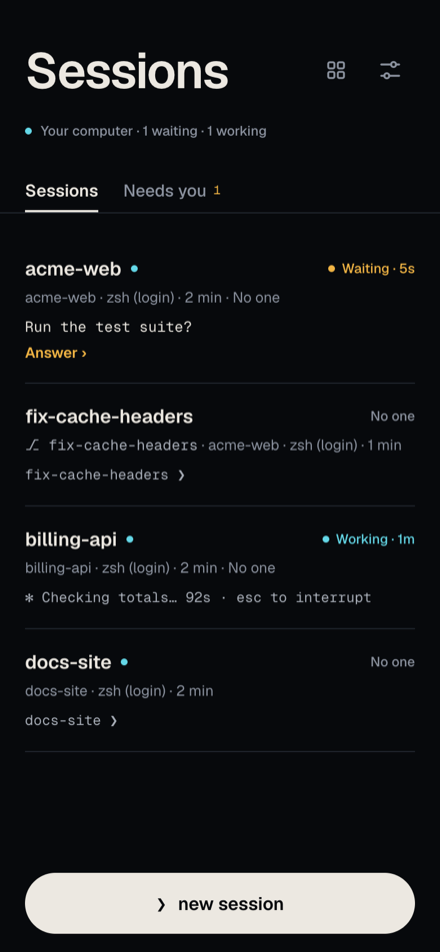
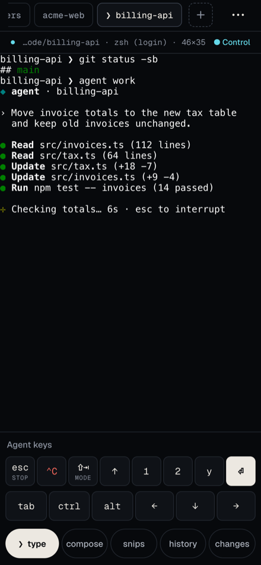
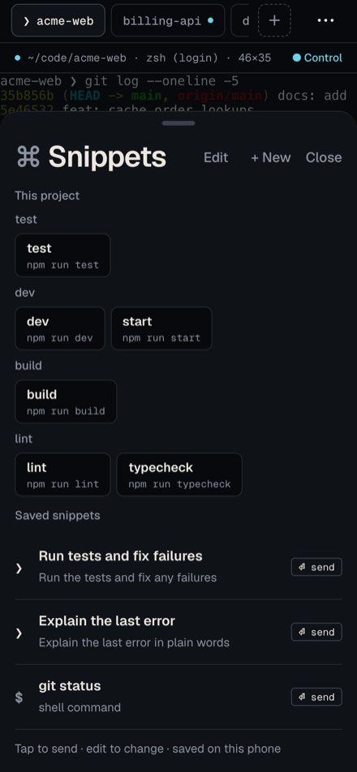
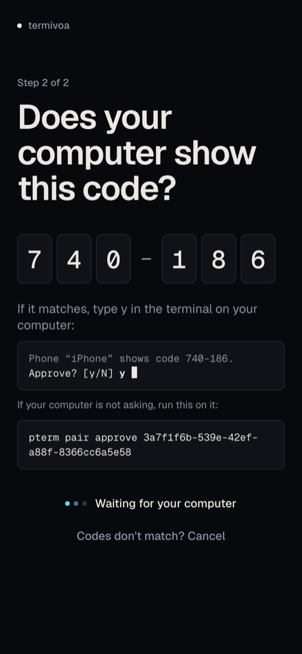
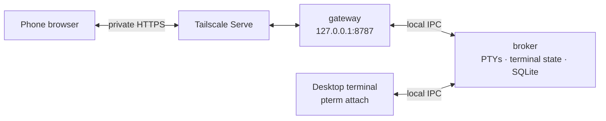

# Termivoa

Control your computer's terminal sessions — shells and AI coding agents such as
Claude Code or Codex — from your phone, privately over Tailscale.

[](LICENSE)

The command-line tool is `pterm`. Some data folders and startup entries keep
the old working name "Phone Terminal" so existing installs keep working (see
[docs/naming.md](docs/naming.md)).

> **Status:** private beta (`v0.1.0-beta.3`, unsigned, invited testers only;
> [install](docs/install.md#private-beta)). The full flow is tested on an
> Apple Silicon Mac. Linux ran in containers and on one real Ubuntu 24.04 VPS.
> Windows support is written but not yet verified on a real Windows machine. There are
> no signed builds.

<p align="center">
  
  
  
  
</p>

## Features

- **Many live sessions.** Start shells or coding agents on your computer and
  switch between them with tabs. A dot shows new output.
- **Files.** Browse, search and read your project's files on the phone, and
  tap a path like `src/app.ts:42` in the terminal to open it there.
- **Worktrees.** Start a task in its own folder and branch from `main` (or
  any branch) with one tap, with a random name you can edit, and Claude or
  Codex already running in it.
- **herdr.** If your computer runs [herdr](https://herdr.dev), the phone shows
  its projects and worktrees with blocked, done and working, buzzes when an
  agent is blocked or finished, opens one herdr terminal in Live and makes new
  worktrees. From the phone you can also open a tab or a workspace, close a tab or a
  workspace, remove a worktree (never one with uncommitted changes) and start
  herdr. A new tab can start a coding agent with a first prompt, a closed
  worktree shows as closed with **Open**, and a herdr terminal has the same
  **⋯** menu. Needs herdr 0.8.2 or later on macOS or Linux; next beta.
- **GitHub.** Connect each computer to GitHub from its page in
  **Settings** with a code, see your repositories, and clone one onto a
  computer with one tap, ready for a new session. No `gh` needed, only git;
  a folder that is already there is never deleted or overwritten. Pull and
  push work in the clone. macOS and Linux, github.com only; next beta.
- **Wall.** Watch all running sessions at once as small live screens, with
  waiting agents first. Tiles only watch; tap one to open it, or hold and
  drag it to arrange the Wall your way. Tiles over the live limit show one
  snapshot of their screen, marked Paused.
- **Computer health.** Each computer's version and last answer on its page
  in Settings, with Check again.
- **Several computers.** Use a Mac, a Linux server and a VPS
  from one phone app: one Sessions list with a side menu to pick a computer (or
  all of them), Settings with one page for each computer, one Wall,
  and new sessions on any of them. Each computer approves the phone itself,
  and **Log out** signs out of every computer it can reach. Not yet tested
  on a real phone; choose an always-on, trusted computer as home, because a
  hacked home reaches every computer added through it. Every user needs
  iOS 16.4 or later on iPhone. Add a computer by scanning
  the QR code from `pterm pair --via` inside the app, by pasting the link,
  or by tapping it in a Termivoa session.
- **Found on your network.** Run `pterm setup` or
  `pterm pair --via <home>` on a new computer, then tap **Add** next to it in
  **Settings**: no link to move. You still compare the code and
  type `y` on the new computer. Not yet tested on a real phone.
- **Agent keys.** One-tap Esc, Ctrl+C, Shift+Tab, Up, `1`, `2`, `y` and Enter
  for coding-agent prompts (Down sits next to Up while you type), plus a key
  bar with Esc, Tab, Ctrl, Alt and arrows.
- **Snippets and project buttons.** Save prompts and commands you send often;
  send them with or without Enter. The same sheet shows the project's own
  commands (package.json scripts, Makefile targets, Cargo and Go) to run in a
  new tab or type here. Nothing runs until you tap.
- **Launch presets and "run first".** Save a project + shell + first command
  and start it in one tap.
- **Composer.** Write long or multi-line text before you send it.
- **History and copy.** Scroll back through bounded history and copy text.
  Next beta: preparing History pages uses less CPU and temporary memory on
  your computer.
  In full-screen apps such as Claude Code, swipe on the terminal to scroll.
- **Agent status and answer cards.** Sessions show **Working**, **Waiting** or
  **Your turn**. Answer Claude Code and Codex questions with one tap; a
  changed question is never answered by mistake.
- **Notifications.** A buzz when an agent waits or finishes, from every
  computer you paired. Only the session name and status, never terminal text.
- **Needs you.** One list of every agent that waits for you, on every
  computer and in herdr, with a **Next** button to go from one to the next.
  A notification tap starts there too. Next beta.
- **Changes view.** See the files the agent changed and each diff, ask the
  agent about a file or picked lines, then commit the ones you pick and push
  (never forced) from the phone.
- **"While you were away" recap.** On return, how long the agent worked, what
  changed, and whether it waits for you.
- **Dev-server preview, photo and voice.** Open the session's dev server on
  the phone, send a photo without location data, or dictate a prompt. The
  preview works for sessions on every computer in your
  list, with the computer's label and an **untrusted page** mark over pages
  from other computers.
- **Desktop attach.** `pterm attach` opens the same session from any desktop
  terminal. Read-only by default; `--control` to type; Ctrl+] detaches.
- **Watching busy terminals.** Next beta reduces CPU and temporary memory
  used on the computer while Live or Wall shows changing output.
- **Sessions survive the phone.** Close the app or lose signal; the session
  keeps running on the computer. Input is never queued or resent on its own.
- **Pairing you can check.** Scan a QR code, compare a short code on both
  screens, approve on the computer. Revoke a phone at any time.
- **Private by design.** Loopback-only server, reachable only through your own
  Tailscale network. No cloud service, no account, no telemetry.

## Quick start

Beta testers can install the release binary
([docs/install.md](docs/install.md#private-beta)). To build from source, you need Go 1.27.1,
Node.js 24.11.0 and pnpm 10.33.0 (build tools only; the host does not need Node).

```sh
git clone https://github.com/intojhanurag/Termivoa.git
cd Termivoa
pnpm install --frozen-lockfile
pnpm build:web && ./scripts/embed-web.sh
go build -tags webdist -o bin/pterm ./cmd/pterm
```

`pterm setup` registers the binary at its current path to start at login, so
keep it at a stable path (or build the app with
`./packaging/macos/build-app.sh` and move it to Applications). On Linux, run
`./packaging/linux/build.sh`, then `./scripts/install-linux.sh
dist/linux/pterm-linux-amd64` (or `-arm64`): it installs `~/.local/bin/pterm`
and runs `pterm setup`. Servers, WSL and the Tailscale operator step:
[docs/install.md](docs/install.md#linux-desktop-server-and-wsl).

Then the three steps from the [quick start](https://termivoa.com/docs/quick-start/):

1. Install [Tailscale](https://tailscale.com/download) on the computer and the
   phone, signed in to the same account.
2. Run `pterm setup`. It checks the host, shows what it will do, and asks once.
   It asks separately before it runs `tailscale serve`. It never uses Funnel.
3. Scan the QR code with the phone. If the phone shows the same code as the
   computer, answer `y`.

To try it without touching startup or Tailscale settings, use the isolated
development profile in [docs/install.md](docs/install.md#development-harness)
(`pterm up --dev`).

## How it works



One Go executable runs as two per-user processes. The **broker** owns every
PTY, the terminal emulator state, authentication and the SQLite database. The
**gateway** serves the embedded web app and API on loopback and forwards each
request to the broker; it never starts a shell. The broker sends clients
server-authoritative screen frames (snapshots and row patches), not the raw
terminal byte stream, and clients send structured input (text, keys, paste)
that goes through one writer per session. Only one device controls a session at
a time. Details: [docs/architecture.md](docs/architecture.md).

## Security model

- The gateway listens on `127.0.0.1` only. Phones reach it through Tailscale
  Serve (private HTTPS inside your tailnet). Tailscale Funnel and public tunnels
  are not supported.
- A new phone needs a single-use, two-minute pairing link and your approval on
  the computer after you compare its code.
- Paired phones use a `__Host-`, `HttpOnly`, `SameSite=Strict` session cookie.
  `pterm revoke <device-id>` ends a phone's access to that computer at once;
  with several computers, revoke it on each one.
- Clients never receive raw terminal bytes and cannot send arbitrary bytes.
- Terminal content is not stored on disk. No telemetry.
- GitHub (next beta) is off until you tap **Connect** for a computer. Each
  computer then keeps its own GitHub login, which never goes to the phone.

A session runs with your user's permissions; projects are not sandboxes. Read
the [threat model](docs/threat-model.md) and [SECURITY.md](SECURITY.md).

## Platform support

| Surface | Target | Status |
| --- | --- | --- |
| Host | macOS on Apple Silicon | Tested (automated suites and a real end-to-end run, macOS 26.5) |
| Host | Windows 11 x64 | Written; cross-compiled only, not run natively yet |
| Host | Linux: Ubuntu 22.04/24.04 desktop, server/VPS and WSL (x86_64, arm64) | Supported; systemd user units, XDG paths. Tested in Ubuntu 24.04 containers (incl. real systemd) and on one real Ubuntu 24.04 x86_64 VPS (setup, sessions, add a computer); arm64 and desktop not yet on real hardware |
| Phone | iPhone Safari and Home Screen app | Tested in desktop Chromium at 390×844; real iPhone pending |
| Phone | Android Chrome | Real device pending |
| Shell | zsh | Tested in isolated fixtures |
| Shell | Linux bash, zsh, fish (login shells) | bash tested in containers and on one real VPS; zsh and fish not tested |
| Shell | Windows PowerShell / PowerShell 7 | Not tested |
| Shell | WSL bash (if installed) | Not tested |
| Network | Tailscale Serve HTTPS | Real tailnet run pending |
| Packaging | macOS DMG, Windows installer, Linux binaries + `scripts/install-linux.sh` | Unsigned builds only |

The full list of what still needs real hardware is in
[docs/owner-verification.md](docs/owner-verification.md).

## CLI reference

| Command | What it does |
| --- | --- |
| `pterm setup` | First run: checks, one confirmation, startup, phone address, Tailscale Serve (asks), pairing. |
| `pterm doctor` | Read-only diagnostics. Never prints secrets. |
| `pterm pair` | Print a pairing link and QR code, then approve the phone after you compare codes. |
| `pterm pair pending` / `pair approve <id>` | Approve a phone later (with `pair --no-wait`). |
| `pterm pair --via <name\|url>` | Add this computer to the phone app on another computer (home). |
| `pterm devices` | List paired phones. `devices rename <id> <label>` renames one. |
| `pterm revoke <device-id>` | Remove a phone's access at once. `revoke --via <url>` removes every phone that uses this computer through that home. |
| `pterm computers` / `computers remove <url>` | On home: show each phone's computers, or remove one from every phone's list. |
| `pterm project add [--name <n>] <path>` / `project list` | Save or list project folders. |
| `pterm github status` / `github disconnect` | Show or remove this computer's GitHub login (next beta). |
| `pterm list` | List sessions and their state. |
| `pterm attach [--control] <session-id>` | Open a session in this terminal. Ctrl+] detaches. |
| `pterm new --project <id> --shell <id>` | Start a session and take control. |
| `pterm terminate <session-id>` | End one session (asks first). |
| `pterm stop` | Stop the gateway only; sessions keep running. |
| `pterm shutdown` | End all sessions and stop the broker and gateway (asks first). |
| `pterm uninstall [--dry-run] [--delete-data]` | Remove startup registration; data only with `--delete-data`. |

Also: `pterm launch`, `pterm config origin`, `pterm profile list|detect` and the
development harness `pterm up --dev`. Run `pterm help` for all flags.

## Development

You need Go 1.27.1, Node.js 24.11.0 and pnpm 10.33.0. Run
`pnpm install --frozen-lockfile`, then `./scripts/check` (Windows:
`./scripts/check.ps1`). Setup, narrower checks and the code layout are in
[CONTRIBUTING.md](CONTRIBUTING.md).

## Documentation

- [User docs](https://termivoa.com/docs/) — quick start, guides, CLI and troubleshooting
- [Install, update and uninstall](docs/install.md)
- [Architecture](docs/architecture.md), [decision records](docs/decisions/), [multi-computer design](docs/multi-computer.md) and [preview on other computers](docs/peer-preview.md)
- [Threat model](docs/threat-model.md) and [authentication design](docs/p4-authentication-design.md)
- [Roadmap](docs/pending-work.md), [progress log](docs/progress.md) and [milestone evidence](docs/evidence/README.md)
- [Owner verification checklist](docs/owner-verification.md)
- [Release checklist](docs/release-checklist.md)
- [Dependencies](docs/dependencies.md) and [dependency patches](docs/dependency-patches.md)
- [Implementation plan](docs/implementation-plan.md) (the original specification)

## Roadmap and known limits

- Real iPhone and Android runs, native Windows 11, real Tailscale Serve HTTPS
  and startup after a real login are still pending
  ([docs/owner-verification.md](docs/owner-verification.md)).
- Signed and notarized builds need the owner's signing identities.
- A live session needs the computer awake, logged in and running the broker.
  Reboot, logout or a broker crash ends live sessions; they are marked lost and
  never restarted.
- Existing terminal processes cannot be adopted; only sessions started by the
  broker can be shared.
- No automatic updater. Open work is in [docs/pending-work.md](docs/pending-work.md);
  defects and risks are tracked in [docs/progress.md](docs/progress.md).

## Contributing

See [CONTRIBUTING.md](CONTRIBUTING.md). Please read the
[Code of Conduct](CODE_OF_CONDUCT.md). Never put credentials, pairing links or
real terminal history in issues, pull requests or screenshots.

## License

[Apache-2.0](LICENSE). Third-party notices: [THIRD_PARTY_NOTICES.md](THIRD_PARTY_NOTICES.md).

---

Made by [Anurag](https://github.com/intojhanurag).
