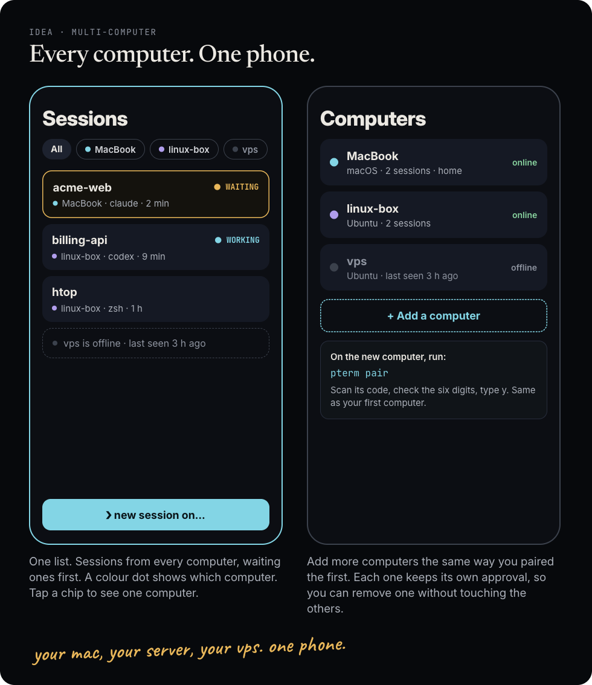

# Multi-computer: architecture

Status: **accepted 2026-10-02, version 4 (two adversarial reviewers over three rounds, plus an outside performance review); implemented in #135 (978041f, merged 2026-10-02); Gate 0 (real phone and second computer, `scripts/gate0/`) still pending and required before release** (ADR [0005](decisions/0005-multi-computer.md)). Sections 7–9 list every review finding and how it is resolved; section 3 "Performance budget" and section 6 "Release gates" carry the performance contract.

One phone uses several computers (for example a Mac, a Linux server and a VPS) from one Home Screen app: one Sessions list, one Wall, new sessions on any computer. This document fixed the architecture, the trust model and the build order before any code was written; #135 implements it.

## 1. Facts this design rests on

| Question | Finding | Evidence |
| --- | --- | --- |
| Is `ts.net` a public suffix? | Yes (PRIVATE section: `ts.net`, `*.c.ts.net`, submitted by Tailscale). The site of `mac.tailX.ts.net` is `tailX.ts.net`: two machines in **one** tailnet are cross-origin but **same-site**; machines in different tailnets are cross-site. | `publicsuffix/list` `public_suffix_list.dat` |
| What do `SameSite=Strict` and `__Host-` allow from origin A to B? | SameSite is decided by site, not origin, so B's Strict cookie **is** sent on same-tailnet requests from A's page (`fetch` with `credentials: 'include'`, WebSocket handshake). `__Host-` and HttpOnly mean A can never read, set or overwrite B's cookie. Inside one tailnet, SameSite therefore gives **no** isolation today; B is protected only by its exact Origin checks. | `internal/gateway/handler.go:226-244`, `api.go:401`, `live.go:74`, `live.go:107-110` |
| CORS today | B sends no `Access-Control-Allow-Origin`, so A cannot read B's responses; mutations need `X-Pterm-Request`, which forces a preflight that B answers with 405. | `handler.go:371` |
| iOS Home Screen app leaving its origin | Links outside the manifest scope open in Safari View Controller, with a different cookie jar and no push. A "switcher" between origins is not a usable app. | WWDC23 "What's new in web apps"; firt.dev iOS 14 |
| WebKit IP-based cookie cap | WebKit caps persistent cookies to 7 days when a same-site subresource's IP differs from the page's IP in the first 16 bits (IPv4) or 64 bits (IPv6). Tailscale IPv4 addresses (100.64.0.0/10) usually differ in the second octet, so peer cookies will be capped over IPv4. | WebKit `NetworkTaskCocoa.mm`, PR #5347, bug 246477 |
| Does it work in real engines? | **Verified by both reviewers:** in Chrome 154 (also with third-party-cookie phase-out) and Playwright WebKit 26.4, a credentialed CORS request from one same-site origin stored the other origin's `__Host-` `SameSite=Strict` HttpOnly cookie and sent it on later `fetch`, preflighted requests and the WebSocket handshake; a cross-site control origin never got it. Not yet verified: standalone iOS Home Screen mode, the IP cap, Android WebAPK. | Throwaway harnesses (two reviewers), 2026-10-01 |
| What can a home service worker do? | **Verified:** a push woke home's service worker with no page open (Chrome), and the worker made credentialed requests and a WebSocket to the peer with `Origin` set to home. | Security review experiment |

## 2. Options

| | A. Switcher | B. Relay through home | C. Bearer tokens on the phone | **D. Direct links (chosen)** |
| --- | --- | --- | --- | --- |
| One list and one Wall | No | Yes | Yes | **Yes** |
| Works as an iOS Home Screen app | No (other origin opens in Safari View Controller) | Yes | Yes | **Yes, if Gate 0 passes** |
| Phone identity on each computer | Per phone | **Lost**: every phone is "home"; breaks per-device leases and uploads (`broker/upload.go:216`, `gateway_rpc.go:168`) | Per phone | **Per phone, unchanged** |
| Revocation | Per computer | All relayed phones at once | Per computer; a stolen token works until revoked | **Per computer** |
| A compromised home computer | Nothing | Holds standing peer credentials: 24/7 shells on every peer | Its JavaScript can exfiltrate every token | **Also compromises every peer** (service worker woken by push; phishing a new pairing); narrowed by per-device binding, owner checks and bound grants (section 3) |
| Latency and availability | Direct | Extra hop; peers unreachable when home sleeps | Direct | **Direct** |
| Plan compliance | OK | Against `docs/implementation-plan.md:230` (loopback, same-origin) | **Violates `docs/implementation-plan.md:248`** (no reusable credential in localStorage) | Keeps HttpOnly cookies and exact Origin checks |

Also rejected: one origin through Tailscale Serve path mapping (every `Path=/` `__Host-` cookie would go to every proxied peer, so each peer would receive home's credential; cookie names clash; all traffic goes through home; each peer needs a Serve change) and Tailscale identity headers (`docs/implementation-plan.md:230`: forwarded identity is ignored; Tailscale is not app authentication).

## 3. Design

### Honest trust statement

**If the home computer is compromised, every computer paired through it is compromised too.** A compromised home serves the app and its service worker, so it can wake the worker with its own push and drive peers with no app open, and it can show the user a fake "pair again" to capture a new pairing. The design narrows this (per-device binding, bound grants, owner checks, `pterm revoke --via`) but cannot remove it: a peer that accepts an app from home trusts home's code. Option D is chosen over B for per-phone identity, leases and direct links, not because it removes this risk. Pick as home the **least exposed always-on** computer (for example a small server you do not run untrusted code on), not the laptop that runs `npm install`, agents and dev previews. Same-user malware on home moves into scope for every peer (`docs/threat-model.md`).

What a compromised home can also do, and how to recover:

- **It can leave code on the phone.** It can register an extra service worker with its own push key; that worker keeps running after home is cleaned (verified in Chrome). The app removes any service-worker registration that is not on a fixed list on every load, and replaces its stored computer list on every load from home, but full recovery needs the steps below.
- **It can get a cookie that works without the phone.** It sees the pairing grant and controls the code the phone shows, so it can redeem the grant from a non-browser client that fakes the `Origin` header and keep a raw peer cookie for up to 30 days.
- **A compromised peer can break the app for all computers** by setting large `Domain=tailX.ts.net` cookies through its responses (every request then grows too large).

**Recovery after a home compromise (required, documented):** run `pterm revoke --via <home origin>` on every peer; clean or replace home; then clear the app's data on the phone, which differs by platform: on iPhone, delete the Home Screen app (its storage, service workers and cookies are its own); on Android the installed app shares Chrome's storage, so also clear that site's data in Chrome (**Settings → Site settings → All sites → the home site → Delete data**). Then add the app and pair again. A test proves that an old service worker cannot intercept a fresh pairing (the app's service-worker allow-list cleanup runs before any pairing request).

### Roles

- **Home**: the computer whose origin serves the app. Its origin must serve only `pterm`: `pterm setup` refuses, before any change, while other Tailscale Serve handlers share that origin (on every computer, also with one computer; exit code 3, which the Windows installer explains), and `pterm doctor` reports them as a problem with the commands to remove them, because any other handler there would control every peer. They must move to another computer or to their own Tailscale Service hostname: another port on the same host still receives the `__Host-` cookie ([RFC 6265 §8.5](https://www.rfc-editor.org/rfc/rfc6265#section-8.5)). Handlers on other ports of the same host are a doctor warning, not a refusal: they are other origins and cannot drive the app, they only receive the cookie when the phone opens them, and refusing would break common setups. Termivoa's own preview port 8443 strips the cookie.
- **Peer**: any other computer. Every request from the app carries that peer's own HttpOnly `__Host-` cookie, scoped to the peer and stored hashed on the peer. No new secret type.

### Per-device origin binding (not a union)

The gateway forwards the request `Origin` with every authenticated call. The broker accepts it only if it is the peer's own origin, or **the app origin bound to that exact credential** (`devices.app_origin`). The gateway keeps a union of bound origins only to emit CORS headers. So a device that paired directly with the peer can never be driven from another computer's app it never approved, and revocation takes effect on the next request, not the next probe. Existing devices migrate with `app_origin = NULL`, meaning "own origin only".

Requests without an `Origin` header are not trusted as "own origin": browsers omit `Origin` on same-origin GETs and on cross-origin `no-cors` GETs, and a `no-cors` GET from any same-site page reaches the peer with its cookie (verified). API requests must carry `Sec-Fetch-Site: same-origin` or a bound `Origin`; `Sec-Fetch-Mode: no-cors` is rejected on `/api`.

Origin parsing is strict: `https` only, default port only (an explicit `:443` is rejected), no trailing dot, no control characters, never `null`, exact host match (near misses such as `xtailX.ts.net` or `tailX.ts.net.evil.com` are rejected), punycode shown as is. WebSocket origin patterns become per request (before #135 they were fixed at start, `handler.go:112-125`, `live.go:109`); `InsecureSkipVerify` is never used. Preflight `OPTIONS` is answered only for exact bound origins.

### Same tailnet is not same owner

Team tailnets, Funnel nodes and reused MagicDNS names all share the site `tailX.ts.net`. At `pterm pair --via`, the peer looks up the app host in `tailscale status --json` and **pins its stable node ID**; the approval prompt shows the machine name, owner and tags.

- **Owner:** for user-owned nodes, the app node must have the same owner as the peer. **Tagged nodes** have no user owner (all tagged nodes share one placeholder), so owners are never compared when either node is tagged; instead the node ID is pinned and pairing requires `--allow-tagged` after the prompt shows the tags. (A tagged server is a good home, so this matters.)
- **Checking later:** the broker caches the status result for about 60 seconds and checks the cached result on **every request** from a bound origin. If the node ID changed, every device bound to that origin is revoked (never re-bound automatically). If status cannot be read, the last good result is kept for a 10-minute grace period; after that, bound-origin requests are refused (not revoked) until a check succeeds. Requests from the peer's own origin are never affected.
- **Finding `tailscale`:** `tailnet.FindBinary` tries fixed install paths first and PATH last, and adds the Homebrew paths, because launchd's `PATH` has neither `/usr/local/bin` nor `/opt/homebrew/bin`. On Unix it refuses a CLI that another user could replace: the file, each link of its symlink chain, and each folder up to `/` (as listed and as resolved) must be owned by root or the current user, and no folder may be group/other-writable without the sticky bit (group root, and group admin on macOS, count as root). `pterm doctor` prints each refusal. The broker checks again before every `tailscale status` run; only the short check-then-exec race remains. Under WSL, Tailscale usually runs on the Windows host, so a WSL computer cannot be a peer (documented).
- **Tags:** the peer pins home's tag set; a node whose tag set changed (as a set: added, removed or replaced) is refused, not revoked.

**Execution contract.** Status refresh runs **asynchronously**: at most one refresh in flight, a hard time limit, and the result published as an immutable, indexed snapshot (node ID → owner, tags, DNS name). Authorization only **reads** the latest snapshot: it never runs `tailscale`, never queries SQLite, and never waits on network work inside a session actor.

**Already-open WebSockets.** When a bound origin stops being trusted (node ID changed, grace expired, device revoked), every open stream from that origin is handled like today's revocation: input and control requests are refused, the controller lease is released, queued actions are dropped (never replayed, rule 10), and the stream is closed with `access.revoked`. Checking only new HTTP requests is not enough.

This only narrows access; it is never used as authentication (`docs/implementation-plan.md:230`).

### Pairing a second computer (bound grant)

1. On the new computer, the user runs `pterm pair --via mac` (or a full origin). A short name matches only the first label of a node's `DNSName` in the peer's **own** tailnet (never `HostName`, which each node chooses, and never shared-in nodes); more than one match is refused, and the prompt always shows the full origin, owner and tags before the node ID is pinned. The grant is **bound to that exact app origin** at creation. Redeem and poll accept only that origin; there is no candidate-origin CORS and no prompt to misread.
2. The link reaches the home app in one of two ways. **Best:** the user runs that command inside a Termivoa session on home (for example after `ssh vps`); the app recognises the add-computer link in the terminal output (link detection already exists for file paths) and shows the link; a tap opens the **Add this computer?** sheet — no camera, no clipboard. Terminal output is untrusted (a program can print a fake link to its own server), so: the button is drawn outside the terminal; it never adds in one tap but opens a confirm sheet with the full origin, machine name and owner; and **home** first checks the link host in its own `tailscale status` (same tailnet, same owner as home, or tagged with confirmation) and pins that node ID. A host that fails the check is refused. **Otherwise:** in **Settings → Computers** tap **+ Add a computer**, then paste. Both paths then load `/computers/add`, which shows the full origin again and redeems nothing until **Continue**; **Cancel** deletes the pending entry on home. `pterm pair --via` prints these exact labels. (The iPhone camera opens links in Safari, a different cookie jar, so there is no camera flow in the MVP; add-to-app links use a distinct marker so the peer's own pair page never consumes them.)
3. The app asks home to record the peer as a **pending** computer for this device (short expiry, shown nowhere) — without this, home's CSP `connect-src` would block the redeem — then opens `/computers/add#…` and removes the fragment at once (the existing pairing pattern; the grant never goes to storage or a query). The reload picks up a CSP that allows the pending origin.
4. The app redeems the grant on the peer with `credentials: 'include'`. The peer checks the bound origin, the owner and the node ID, then its CLI asks: `Phone "iPhone" shows code 123-456 and will use this computer from the Termivoa app at mac (https://mac.tailX.ts.net, owner ada@example.com). Approve? [y/N]`
5. On approval the peer sets its cookie and records `devices.app_origin` and the node ID.
6. Only after the app's first authenticated `GET /api/v1/settings` on the peer succeeds does home confirm the computer — **in this device's list** (`computers` keyed by device ID), never a global list. Pending entries that are not confirmed expire and are deleted; they are shown nowhere.

**First-pairing CORS.** Before any device exists, the bound-origin union is empty, so pairing routes need their own admission: the gateway admits an origin on `/api/v1/pair/*` only while an **unexpired grant or pending pairing bound to that exact origin** exists (the broker includes these in the origin probe). Preflight is answered from that route-specific set, because a preflight carries no cookie and no body. Each real redeem and poll request still forwards its `Origin` to the broker, which verifies it against **that request's own** grant or pending pairing.

Peer CORS, for bound origins only: exact `Access-Control-Allow-Origin`, `Access-Control-Allow-Credentials: true`, `Vary: Origin`; preflight allows `GET, POST, PATCH, DELETE`, headers `Content-Type, X-Pterm-Request`, `Max-Age: 600`.

### Keeping the cookie alive (7-day cap)

The peer sends its cookie again on every authenticated `GET /api/v1/settings` (the app reads it at start and on return to the foreground), so the WebKit 7-day cap never ends a session with regular use. Rules: the **same value** (never a new one, so parallel requests cannot race); `Max-Age` no longer than the credential's **remaining absolute lifetime**; the server never extends any expiry; only on requests that passed every check above; never on a 401. A test proves a revoked or expired credential never gets a `Set-Cookie`. This is in the MVP.

### One list, one Wall

- Computer key: the canonical origin. Session key: `host/sessionId`; a peer cannot collide with or impersonate another computer's session.
- Routes: home keeps `/sessions/<id>` (push links keep working); peers use `/c/<host>/sessions/<id>`.
- Label: the first DNS label (`vps`), renameable. Colour from a fixed palette by place in the list, home first, always with the text label. Labels come from the origin the phone dialled, never from the peer.
- The HTTP client becomes per computer (`client(origin)`); `Connection` already takes any URL.
- New session: pick the computer first, then its projects and shells. Unreachable computers are disabled.
- Wall: tiles from all computers, governed by the phone's terminal-work budget below (visibility alone does not bound cost).

### Performance budget (the phone is the bottleneck)

A small stream on the wire can still be large work on the phone: an outside review measured, on one local broker with a 1 MiB/s terminal and three viewers, about 6.5 MiB/s of decoded JSON from 0.13 MiB/s of compressed traffic. Every message is parsed and validated **on arrival, before** animation-frame coalescing (`Connection.ts:818-828`), each Wall tile builds its own full terminal renderer and connection (`Wall.tsx:128-130`), and browser WebSockets have no receive backpressure, so limiting paint rate alone is not enough.

- **One phone-wide scheduler** owns a budget for live tiles, open connections, decoded bytes per second and reconnect attempts.
- **The active terminal comes first**: it keeps today's limits; Wall tiles and background observers are suspended when offscreen or when the app is in the background.
- **Thumbnail streams are throttled at the source:** starting point **4 live Wall thumbnails at 5 updates per second, enforced by the broker** for read-only thumbnail viewers. This stays revision-correct because each patch is built from that viewer's last delivered frame to the latest (`internal/broker/viewer.go:322`, `:709-735`); history notices use their own path and are not throttled. A skipped delivery arms a **trailing timer** that delivers when the next slot opens, so output that stops mid-burst still paints (tested). The numbers are tuned on real phones.
- **Tiles beyond the live limit** show their last frame with a **Paused** mark (a tile that was never live shows the session name and Paused) and go live again when they become one of the live tiles.
- **Older peers** that do not support the `thumbnail` mode (attached without it, by revision gating) count as full-rate streams in the budget, or show a static tile.
- Every limit has a test, and the release gates in section 6 measure it.

### Peer responses are untrusted

Every message from every computer (HTTP responses and WebSocket frames) is validated with one lenient set of precompiled (standalone) Ajv validators — never `'unsafe-eval'` — that drops unknown fields but rejects wrong types. Plain `removeAdditional` breaks today's WebSocket envelope (its top-level `oneOf` strips fields while trying branches; verified on the real schemas), so the envelope gains `"discriminator": {"propertyName": "type"}` and Ajv runs with `discriminator: true` and `removeAdditional: true` (verified to keep known fields and drop unknown ones, also in standalone output). Lists are validated **per item**, so one bad session does not hide the whole list. Requests use `redirect: 'error'` and size limits. Peer error messages are replaced with generic text, so a peer cannot show phishing text in the home app. No previews from peers in the MVP.

### Home offline, and one computer offline

- The app ships as a **versioned, complete offline bundle**: on install, the service worker prepares the HTML (with its CSP) and **every** JavaScript and CSS chunk of that version (Live, Wall and Preview are lazy chunks, `App.tsx:18-21`; the old service worker cached each one only when it was first requested, while the new `sw.js` precaches the whole bundle at install), and switches versions only when the new bundle is complete; an interrupted update keeps the old one. A test opens an **unvisited Wall while home is offline**. Cold launch is measured separately, because a navigation timeout adds delay before peers start.
- Navigation becomes network-first with a **2–3 second timeout** and the cached bundle; the shell is re-cached on successful navigations **only when the HTML's build ID matches the service worker's version** (otherwise it is served but not cached, so an old worker never stores a new build's HTML that points to chunks it lacks), so its CSP follows added and removed computers. Preparing the bundle during `install` fits today's update model: the new worker fills its cache, then waits for the user's reload (no `skipWaiting`). (`index.html` and its CSP now depend on the device cookie.) The computer list (origins and labels, not secret) is kept in `localStorage` and replaced on every load from home. If home is unreachable, the app still opens and reaches the peers; home is treated as one more computer.
- Each computer loads independently under one scheduler with global limits: at most **8 peer computers plus home**, at most one outstanding poll per computer, at most **3 concurrent reads** and **2 concurrent connection attempts** across all computers, jittered retries, and an offline cooldown. Each computer's result is shown as soon as it arrives (never waiting for the slowest), so a sleeping VPS never delays opening the Mac's terminal. An unreachable computer shows **"vps · can't reach"** with Retry; session lists are not cached (titles and folders are private).
- A 401 from a peer shows **"vps · pair again"** and never logs the app out of home or of other peers.
- Changing which computer is home means a new Home Screen icon (a new cookie jar), so every peer must be paired again. Documented.

### Versions

`HTTPSettingsResponse.protocolRevision` (an integer) plus a minimum supported revision. Computers can be updated one at a time, with three rules: unknown response fields are dropped (lenient validation); a newer app sends a **new request field only to peers whose revision supports it** (Go decodes requests strictly, `api.go:450`, `internal/protocol/message.go:818`); and a **new enum value** that older apps must parse either raises `minProtocolRevision` or is mapped to `unknown` before validation. The app refuses only a peer below the minimum ("Update Termivoa on vps").

### Removing a computer, and a lost phone

- **Remove computer** first calls `POST /api/v1/logout` on the peer (revoking this device's credential there), then removes it from the list. If the peer is unreachable, the app says to run `pterm revoke` on it.
- `pterm revoke --via <origin>` on a peer revokes every device bound to that app origin (for example after home is compromised).
- `pterm revoke` on home prints the computers that phone was using, so a lost phone can be revoked everywhere.
- Reinstalling Tailscale on home gives it a new node ID, so each peer revokes the phones bound to home and they must pair again (documented in troubleshooting).
- Home pins each listed peer's node ID too (`computers.node_id`): confirm needs the same node ("this name now belongs to another Tailscale machine; add the computer again"), and once home has a snapshot, an entry whose name now belongs to another node leaves the list and the CSP (a name merely missing from status stays listed as unreachable, so its user can remove it), so a peer whose Tailscale was reinstalled must be added again. A pending add over an entry pinned to another node (or none) replaces it with a pending entry for the current node; when the list is full, hidden entries are deleted to make room.
- Reinstalling Tailscale on home: the peer keeps home's origin in its CORS list (a Changed verdict), so the app reads the peer's 401 `revoked` and shows "pair again"; every credential bound to that origin is revoked, and every other credential and grant is refused there.
- **Log out** in Settings signs out of every reachable peer first (`POST /api/v1/logout`), then home, and names the peers it could not reach ("Run pterm revoke there to remove this phone.").
- `pterm revoke --via <origin>` always sends the request, also with no bound device, because it also deletes that app's pairing grants and pending pairings.
- `pterm computers remove` on home cannot log the phone out on the peer, so it prints "run `pterm revoke` on <peer>"; the app drops the computer on its next load from home.

### Notifications

Push from home only in the MVP (as built: the app subscribes on home only); peer Waiting and Working states show in the list and on the Wall while the app is open. A service-worker registration must be on the page's own origin, so peer push means several scoped registrations on home's origin, each subscribed with one peer's VAPID key. Gate 0 tests this on iOS; if it works, it is the first follow-up.

## 4. Protocol and storage changes (rule 6)

All additive within v1, regenerated Go and TypeScript types:

- `http-api.schema.json`: `protocolRevision`, `minProtocolRevision`; `HTTPComputer {origin, label}`; `GET/POST /api/v1/computers`, `DELETE /api/v1/computers/{host}` (per device).
- `gateway-rpc.schema.json`: forwarded request `origin` on authenticated calls; `boundOrigins[]` (at most 64) on the origin probe result for CORS headers; `gateway.computers.*`.
- `admin-rpc.schema.json`: `appOrigin`, owner, tags and node ID on pairing grants, pending pairings and devices; `allowTagged` on grant creation; `admin.computers.list/remove`; `revoke` by `via`.
- WebSocket envelope: a `discriminator` on `type` (validation only; no wire change); `session.attach` gains an optional read-only `thumbnail` mode with a maximum update rate, which the broker enforces per viewer (screen frames are coalesced to that rate; canonical PTY processing is unchanged).
- Store schema (`internal/store/migrations/001_schema.sql`): `pairing_grants.app_origin`, `pending_pairings.app_origin`, `devices.app_origin`, `devices.app_node_id` (NULL = own origin only); `computers(device_id, origin, label, state ('pending'|'confirmed'), expires_at_ms, created_at_ms, PRIMARY KEY (device_id, origin))`.

CLI: `pterm pair --via <name|origin> [--allow-tagged]`; `pterm computers` and `pterm computers remove <origin>` on home; `pterm devices` gains a **Via** column; `pterm revoke --via <origin>`; `pterm doctor` reports bound origins, the CORS list, the protocol revision, tailnet and owner mismatches, and other Serve handlers on home's origin.

## 5. Stack review: which language is best here?

The owner asked for the best stack for performance, in any language.

| Option | Fit |
| --- | --- |
| **Go (current)** | One static binary per platform, fast startup, low memory, excellent networking and TLS-free loopback HTTP, mature PTY and SQLite support already in place, cross-compiles to macOS, Linux and Windows. |
| Rust | Lower memory and no GC pauses. But a rewrite would discard a tested broker, gateway and protocol stack and slow every feature, and no profile shows a host-side bottleneck yet. Terminal output can far exceed typing speed, so allocation and GC cost are measured, not assumed. |
| Node or Bun (TypeScript) | Shares code with the web app, but needs a runtime on every computer (against ADR 0001 and AGENTS.md rule 2), uses more memory, and is weaker for PTY supervision on Windows. |
| Zig or C++ | Highest control, far more risk and effort, no benefit for this workload. |

**Decision: keep Go, with a profiling requirement.** Multi-computer adds direct phone-to-computer links, not a new host hot path. Before any component is rewritten or memory limits are tuned, profile the broker's terminal emulator, frame encoding per viewer, and allocation/GC under the release-gate load. The measured bottleneck today is the phone, not the host. The phone side stays TypeScript and React (shared types are generated from the JSON Schemas). If profiling ever shows a hot spot (for example the terminal emulator), that one component can be optimized in place.

## 6. Build plan

### Gate 0 (blocking; owner, real iPhone and Android)

A small harness, now committed (`scripts/gate0/`, see its README; earlier reviewer experiments were throwaway and are reported, not reproducible, evidence: one HTTPS endpoint that sets and echoes a `__Host-` Strict cookie with credentialed CORS and a WebSocket) runs behind Tailscale Serve on two machines in one tailnet. Running it changes Tailscale Serve, so it needs the owner's approval (rule 12). From the installed home app, over **IPv4**:

1. A credentialed `fetch` to the peer sets its cookie; later `fetch` and the WebSocket send it.
2. The cookie survives killing the app and rebooting the phone, and stays in the app's own cookie jar.
3. The cookie's expiry, read in Safari Web Inspector (shows whether the 7-day cap applies; no need to wait 7 days).
4. A push-woken service worker can make credentialed requests (this is the threat, documented either way).
5. Scoped service-worker registrations on home's origin can each receive push with a different VAPID key (peer push).
6. Paste-pairing inside the installed app works end to end.
7. The same checks on Android (Chrome WebAPK).

The 7-day cap is not a stop condition (rolling refresh covers it). If checks 1 or 2 fail, stop and decide on plan B.

**Plan B (if cookies fail on iOS):** one non-extractable WebCrypto key per peer in IndexedDB signs requests and a WebSocket challenge, over non-credentialed CORS. It keeps per-device identity and does not depend on cookies, but it changes `docs/implementation-plan.md:248` (no reusable credential in browser storage), so it needs an owner decision and its own security review.

### Tracks (no shared files)

| Track | Owns | After |
| --- | --- | --- |
| P. Protocol | `protocol/v1/*` (including the envelope discriminator and a **new** attach payload type for `session.attach`, not an edit of the shared `emptyPayload`), generated Go and TypeScript, protocol revision | Gate 0 |
| H1. Broker | store migration and store, the attach and viewer path (`internal/broker/viewer.go`, `session.go`, `session_dispatch.go`: thumbnail mode, rate limit, trailing timer), `internal/auth/service.go`, broker gateway and admin RPC (origin binding, owner and node checks, `revoke --via`), `internal/gatewayclient`, `internal/gatewayapi`, new `internal/tailnet` (status lookup and cache) and the move of the status parsing out of `internal/lifecycle/checks.go` into it | P |
| H2. Gateway and CLI | `internal/gateway/handler.go`, `api.go`, `live.go`, `server.go` (CORS, per-request WebSocket origins, `Sec-Fetch` checks, cookie refresh, forwarded Origin, probe loop and bound-origin union), `internal/cli/admin.go`, `cmd/pterm` (`pair --via`, `computers`, `devices`, `doctor`, Serve-handler check; replaces `installedTailscale` with a call to `internal/tailnet` after H1 lands) | P (fakes until H1) |
| W1. Web core | the phone-wide scheduler (new module driving `Connection.ts` and `hooks.ts`), `web/src/api/http.ts`, `web/src/computers.ts`, `web/src/pairing/*`, `web/src/screens/hooks.ts`, `web/src/terminal/Connection.ts`, `web/src/protocol/validate.ts`, `web/vite.config.ts` (lenient peer validators) | P |
| W2. Screens and app shell | `App.tsx` (per-computer auth and offline), `Sessions.tsx`, `Wall.tsx` (live tiles within the budget, Paused tiles beyond it), `NewSession.tsx`, `Settings.tsx` (Computers: add, rename, remove, retry), `Live.tsx`, `web/src/sw.js` (network-first shell, service-worker allow-list cleanup), `web/src/push.ts`, `Composer.tsx` (uploads), `SessionMenu.tsx`, `Worktree.tsx`, `web/src/screens/activity.ts` (keys become `host/id`), `web/src/terminal/pathLinks.ts` and `TerminalView.ts` (the add-computer link) | W1 |
| D. Docs | guide `computers.md`, security, CLI, troubleshooting, pairing, release notes, `docs/threat-model.md` (new trust boundaries), HTTP API doc, CHANGELOG, README, progress, landing page | drafts now, final after integration |

**Contract between W1 and W2:** `web/vite.config.ts` (W1) emits the list of every file in the build, with the build ID; `web/src/sw.js` (W2) prepares exactly that list at install.

### Integration tests

Cookies ignore ports, so two loopback dev stacks would overwrite each other's cookie. Integration tests instead run Playwright (Chromium and WebKit) with `--host-resolver-rules="MAP *.tailx.ts.net 127.0.0.1"`, self-signed TLS and those names in the dev Host allow-list. Required tests: per-device origin binding, near-miss and `null` origins, a reused node name (owner and node ID checks), bound grants refused from other origins, cookie refresh, a push-woken service worker, one computer offline, a 401 from one peer, and home offline with the cached shell.

### Release gates (performance)

Multi-computer is not called fast until these pass. They extend `docs/implementation-plan.md` §13 and keep its targets: **p95 under 30 ms app-added key-to-frame latency** (at least 1,000 events, host receive-to-frame and browser send-to-paint measured on their own clocks) and **p95 under 2 seconds authenticated foreground reconnect**. Each benchmark records the actual Tailscale connection type (direct, DERP relay or peer relay).

| Scenario | Required evidence |
| --- | --- |
| Active terminal while other computers flood output | Host receive-to-frame and browser send-to-paint latency, compared with the single-computer baseline |
| Maximum supported Wall | Phone CPU, memory, decoded bytes, frame freshness and responsiveness |
| Sleeping or failing computer | Healthy computers usable at once; retry traffic stays bounded |
| Network changes | Real iPhone and Android, Wi-Fi and cellular, direct and relayed paths, return to foreground |
| Sustained load | The ten-minute stress test and 24-hour soak extended across computers |

### MVP and follow-up

**MVP, in two milestones before release.** **M1:** bound-grant pairing (in-app link and paste), owner and node checks, per-device origin binding and `Sec-Fetch` checks, rolling cookie refresh, per-device computer list, one Sessions list, Live, new session on any computer, per-computer "can't reach" and "pair again", lenient validation and protocol revision. **M2:** the home-offline app shell, the cross-computer Wall, remove-with-logout and `revoke --via`, service-worker cleanup. Full MVP list: bound-grant pairing with owner and node checks; per-device origin binding; per-device computer list; one Sessions list with labels and colours; Live (control, compose, history, Files and Changes, uploads); new session on any computer; Wall with visible-only tiles; per-computer offline and "pair again"; home-offline app shell; lenient validated peer responses; protocol revision gate; rolling cookie refresh; remove-with-logout and `revoke --via`; push from home only; no previews from peers.

**Follow-up:** push from peers (if Gate 0 check 5 passes); previews from peers; QR scanning inside the app. Different tailnets stay out of scope.

## 7. Adversarial reviews: findings and resolutions

Two independent reviews (security; feasibility and alternatives) ran on version 1. Both concluded: keep option D, with changes. Every finding is resolved in this version:

| # | Finding (severity) | Resolution |
| --- | --- | --- |
| 1 | A compromised home compromises every peer, even with no app open (push-woken service worker; phished re-pairing) (high) | Stated plainly in "Honest trust statement" and the ADR; home choice guidance; bound grants, owner and node checks, `revoke --via` |
| 2 | Allowed origins were a union, not bound per device (high) | Per-device origin binding in the broker; union used only for CORS headers |
| 3 | Same tailnet is not same owner (team tailnets, Funnel, reused names) (high) | Owner and stable node ID checked at approval and on every probe |
| 4 | Open CORS on pairing routes made pairing phishable (medium-high) | Grants bound to one app origin at creation (`pterm pair --via`); no candidate-origin CORS |
| 5 | Global computer list, written before approval (medium) | Per-device list, added only after peer approval and an authenticated read |
| 6 | 7-day WebKit cookie cap would log peers out weekly (high) | Rolling cookie refresh in the MVP; Gate 0 reads the expiry |
| 7 | Home offline kills the app (high) | Network-first navigation with a cached app shell; home treated as one more computer |
| 8 | Exact fingerprint forces updating all computers at once (high) | Integer protocol revision with a minimum; lenient peer validation |
| 9 | Peer push as written cannot be built (high) | Scoped registrations on home's origin, tested in Gate 0; follow-up |
| 10 | Integration test plan broken (cookies ignore ports) (high) | Host-resolver mapping, self-signed TLS, Playwright Chromium and WebKit |
| 11 | Gate 0 not cheap without a test server (medium) | Committed harness and a 7-point checklist; plan B defined |
| 12 | Camera opens pairing links in Safari (medium) | Paste-only MVP; distinct add-to-app link marker |
| 13 | Remove and revoke gaps; lost phone (medium) | Remove calls logout on the peer; `revoke --via`; home lists computers to revoke |
| 14 | Grant carried across a reload (medium) | `/computers/add#…` with immediate fragment removal |
| 15 | Other Serve handlers on home's origin control all peers (medium) | Setup and doctor refuse other handlers on that origin |
| 16 | Many Wall sockets on a phone (medium) | Only visible tiles connect; staggered reconnects |
| 17 | Track gaps (`Connection.ts`, `validate.ts`, `sw.js`, `push.ts`) (medium) | Assigned to W1 and W2 |
| 18 | Missing migration, Settings UX, doctor output, abandoned adds (medium) | `app_origin = NULL` means own origin only; Settings and doctor scoped; adds only after approval |
| 19 | Malicious peer text in the home app (low) | Generic peer errors, `redirect: 'error'`, size limits, standalone validators |
| 20 | WebSocket origins fixed at start; origin parsing traps (low) | Per-request WebSocket origins; strict origin parsing rules |
| 21 | One reason for rejecting Serve path proxying was wrong (low) | Corrected in section 2 |

## 8. Round 2 reviews: findings and resolutions

Both reviewers attacked version 2. Security: "sound with changes". Feasibility: "keep D with changes". Resolved in this version 3:

| # | Finding (severity) | Resolution |
| --- | --- | --- |
| 22 | A compromised home can leave a service worker on the phone that survives cleanup (verified) (high) | Service-worker allow-list cleanup on every load; stored list replaced from home; required recovery steps (revoke via, delete the app, pair again) |
| 23 | v2 pairing could not work: home's CSP blocked the redeem (high) | Pending computer per device (short expiry) before the reload and redeem |
| 24 | Lenient Ajv broke the WebSocket envelope (verified) (high) | Envelope discriminator, `discriminator: true` with `removeAdditional: true`, one lenient set for HTTP and WebSocket |
| 25 | A new enum value or request field still forced updating all computers (verified) (high) | Per-item validation; request fields gated by peer revision; enum-widening rule |
| 26 | A stolen grant gives a cookie that works without the phone (medium) | Stated in the trust statement; `revoke --via` is a required recovery step |
| 27 | Owner check breaks on tagged nodes (medium) | Owners not compared when tagged; node ID pinned; `--allow-tagged` after showing tags |
| 28 | Tailscale check failures undefined; `status` runs every second (medium) | 60 s cache, checked per request; 10-minute grace then refuse; revoke only on a definite ID change; PATH fallback; WSL not supported as a peer |
| 29 | GETs without `Origin` bypass binding (verified) (low-medium) | `Sec-Fetch-Site`/bound `Origin` required; `no-cors` rejected on `/api`; refresh only on passing requests |
| 30 | Cookie refresh rules unwritten; per-credential state missing (low) | Same value, capped `Max-Age`, never server-side extension, never on 401, sent on each settings read; test |
| 31 | `pair --via` is hard from SSH on Linux (medium) | Short names; in-app **Add this computer** from the link in a Termivoa session |
| 32 | Stale CSP or list after removal; slow launch when home sleeps (low-medium) | Re-cache the shell on each navigation; replace the list on each load; 2–3 s navigation timeout; CLI remove prints the revoke hint |
| 33 | A compromised peer can bloat cookies for all computers (low) | In the trust statement; recovery is deleting the app |
| 34 | Track gaps and overlap (`server.go`, Tailscale status code, `Composer`, `SessionMenu`, `Worktree`, `activity`) (medium) | Assigned to H2, H1 (`internal/tailnet`) and W2 |
| 35 | MVP too large for one step (low) | Split into M1 and M2, both before release |

## 9. Outside performance review (version 4)

An outside review of version 3 (with a local benchmark) found no error in the direction and asked for contracts that version 3 lacked. Each claim was checked against the code before it was accepted:

| # | Finding | Checked | Resolution |
| --- | --- | --- | --- |
| 38 | No phone-wide terminal-work budget; visibility does not bound cost; parse and validate happen before coalescing (P1) | True: `Wall.tsx:128-130`, `Connection.ts:818-828` | "Performance budget": one scheduler, active terminal first, broker-enforced thumbnail rate, starting at 4 tiles × 5 updates/s |
| 39 | Trust checks need a non-blocking execution contract and must affect already-open WebSockets (P1) | True: not specified | Async single-flight refresh with immutable snapshot; open streams refused, lease released, queued actions dropped, closed with `access.revoked` |
| 40 | Cross-computer polling and reconnects need global bounds (P2) | True | One scheduler: 8 peers plus home, 1 poll each, 3 reads, 2 connects, jitter, cooldown, results shown as they arrive |
| 41 | "Home offline" needs a complete offline bundle, not a cached shell (P1) | True: lazy chunks `App.tsx:18-21`, cached on request `sw.js:62-70` | Versioned complete bundle, atomic switch; test an unvisited Wall offline; cold launch measured |
| 42 | First-pairing CORS had no mechanism before a device exists (P2) | True | Route-specific admission from unexpired grants and pending pairings; per-request verification on redeem and poll |
| 43 | Gate 0 harness described as committed but absent; recovery not portable (P2) | True: `scripts/gate0/` absent; Android shares Chrome storage | Harness marked "to be committed first"; platform-specific recovery; old-worker test |
| 44 | Go claims too strong ("human speed", "GC not a bottleneck") | Fair | Replaced by a profiling requirement |
| 45 | Direct links may still run over a Tailscale relay | Fair | Benchmarks record the connection type |
| 46 | Performance release gates missing | True | "Release gates" in section 6, keeping `docs/implementation-plan.md` §13 targets |

**Final check of version 4 (feasibility reviewer):** confirmed with notes, all resolved: (47) the shell is cached only when its build ID matches the worker; (48) a trailing timer so throttled thumbnails never stay stale; (49) older peers without thumbnail mode count as full rate or show static tiles; (50) attach and viewer path to H1, the scheduler to W1, a bundle-list contract between W1 and W2, a new attach payload type; (51) Wall tiles beyond the live limit show their last frame as Paused. Bundle-at-install fits the no-`skipWaiting` model, and the broker rate limit stays revision-correct (checked in `viewer.go`).

**Final confirmation round (version 3):** feasibility — confirmed with notes, all resolved: the `internal/tailnet` move is split between H1 (new package, `checks.go`) and H2 (`cmd/pterm` call site); `pathLinks.ts` and `TerminalView.ts` go to W2; a home reinstall changes the node ID (documented). Security — confirmed with two notes, both resolved: (36, medium) a program printing a fake add-computer link to its own server could add a fake computer → home checks the host in its own `tailscale status` (same tailnet and owner), pins the node ID, and always asks in a confirm sheet drawn outside the terminal; (37, low-medium) short `--via` names could match the wrong node → match only `DNSName` first labels in the peer's own tailnet, refuse ambiguity, always show the full origin.

## Sources

- [WebKit NetworkTaskCocoa.mm (IP cookie cap)](https://github.com/WebKit/WebKit/blob/main/Source/WebKit/NetworkProcess/cocoa/NetworkTaskCocoa.mm)
- [WebKit bug 246477](https://bugs.webkit.org/show_bug.cgi?id=246477)
- [WebKit: full third-party cookie blocking](https://webkit.org/blog/10218/full-third-party-cookie-blocking-and-more/)
- [RFC 6265 §8.5: cookies ignore ports](https://www.rfc-editor.org/rfc/rfc6265#section-8.5)
- [Tailscale ipn/serve.go](https://github.com/tailscale/tailscale/blob/main/ipn/serve.go)

- [Public Suffix List](https://raw.githubusercontent.com/publicsuffix/list/main/public_suffix_list.dat)
- [WWDC23: What's new in web apps](https://developer.apple.com/videos/play/wwdc2023/10120/)
- [firt.dev: iOS 14 for PWA developers](https://firt.dev/ios-14/)
- [WebKit PR #5347: 7-day cap for cookies from a different IP](https://github.com/WebKit/WebKit/pull/5347)
