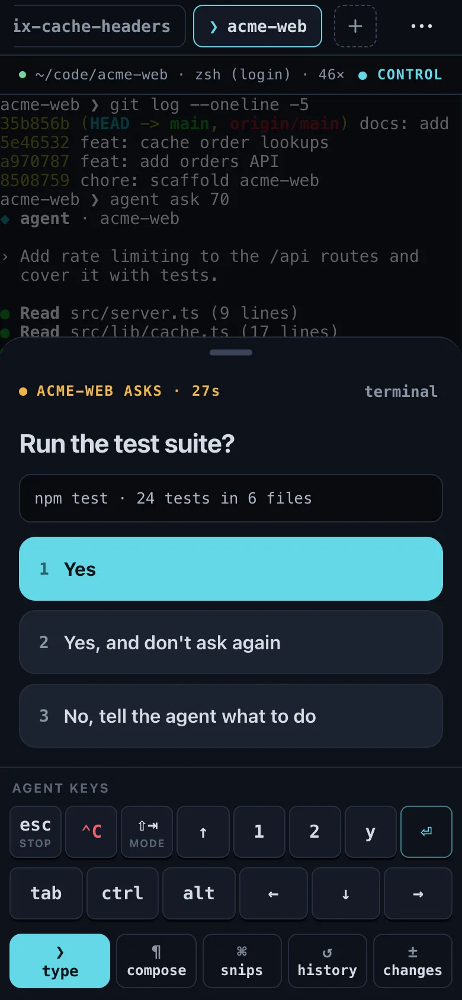

When Claude Code or Codex asks a question, such as "Do you want to proceed?", Termivoa shows a one-tap answer card on your phone.

## What does an answer card show?

The card sits at the bottom of the live terminal:

- the question;
- what you approve, such as the exact command;
- a button for each option.

Other programs' numbered menus and `[y/N]` prompts get cards too.

## Answer a question

1. Open a session with the **Waiting** badge.
2. Read the question and what it approves.
3. Tap one option. Without control, tap **Take control to answer** first.

One tap sends one answer. Termivoa never answers or retries on its own. Tap **terminal** to fold the card into an **↑ answer** pill and see the terminal; tap the pill to reopen it.

## Why can a tap not answer the wrong question?

Before your answer reaches the program, your computer checks that the same question, approving the same thing, is still on screen. It checks again just before it types. If the question changed, the answer is dropped and you keep control. The card shows the question that is on screen now; when the first check finds the change, it also says **The question changed — check the new one**.

Prompts that ask the same thing about different commands are different questions. The same prompt and command twice in a row count as one, so an answer for the first can answer the second.

## When does no card show?

- Menus without numbers, like Claude Code's folder-trust dialog, get no card; use the arrow keys and `⏎`.
- Agent updates can change screens. Without a card, answer with the [agent keys and key bar](/docs/guides/live-terminal/#use-the-agent-keys-and-key-bar).
