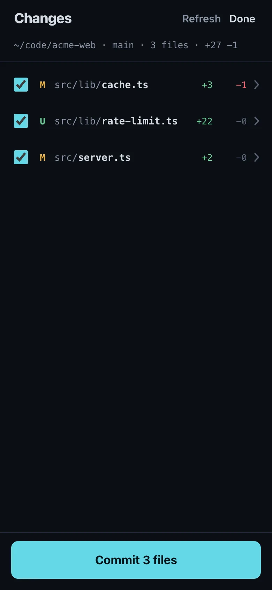
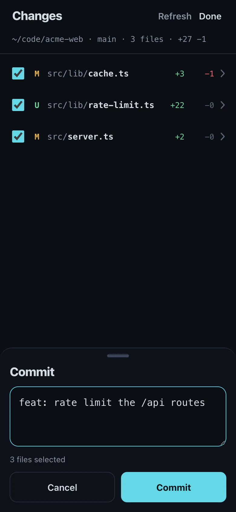

The Termivoa **Changes** view shows what a coding agent changed in your project: the changed files and a red and green diff for each.

## What does Changes show?

The uncommitted changes in the session folder's git project: what `git status` and `git diff` show, plus new files that git does not ignore. You can see them without control. Changes never edits files; with control, you can [commit and push](#commit-and-push).

## See the changed files

1. Open the session.
2. Tap **changes** in the dock. When you only watch, tap **Changes** under **Take control**.
3. The top line of the list shows the folder, branch, file count, and lines added and removed.

Each row shows a change letter, the path, and the lines added (green) and removed (red).

| Letter | Meaning |
| --- | --- |
| **M** | Modified |
| **A** | Added |
| **D** | Deleted |
| **R** | Renamed |
| **U** | New, not yet added to git (untracked) |
| **T** | Type changed |

**Refresh** reads the changes again. **Done** goes back to the live terminal.

## See one file

Tap a file to see its diff. Added lines are green, removed lines are red, and the numbers at the left are the old and new line numbers. The back arrow returns to the list.

## Ask the agent about a file

1. Open a file.
2. Tap **Ask agent about this file**. The compose sheet opens with `@` and the file path.
3. Write your question and tap **Send ⏎**. Sending needs control.

## Ask about specific lines

1. Open a file and tap a line in the diff.
2. To pick a range, tap a second line. A range has 20 lines at most and stays in one part of the diff.
3. Tap **Ask agent about line 42** or **Ask agent about lines 40–42**. The compose sheet opens with the path, line numbers and picked lines.
4. Write your question under the lines and tap **Send ⏎**.

To clear, tap a picked line or **Clear**. The numbers are the new line numbers, or the old ones when you pick only removed lines.

## Commit and push

You need control. Without it, the list shows **Take control to commit**.

1. Open **Changes**. All files are ticked. Untick the ones you do not want in the commit.
2. Tap **Commit N files**.
3. Check the message. Termivoa writes a first message from the file names, for example `Update app.js and 4 more files`.
4. Tap **Commit**.
5. After **Committed**, tap **Push**, then **Push** again to confirm.
6. After **Pushed**, tap **Open pull request** if the remote gave a link.

If git fails, the sheet shows its output, such as a hook error. The list reloads after each commit. If the connection stops during a commit or push, Termivoa does not send it again. Check the list before you retry.

:::caution
The commit runs your repository's own hooks, as a commit on your computer does. Push never forces, so it cannot overwrite commits on the remote.
:::

## What are the limits?

- Only the first 300 changed files are shown. Run `git status` to see all.
- A very long diff is cut short, and the screen says so.
- If the folder is not in a git project, Changes says so.

:::caution
Any phone paired with this computer can see these diffs, also when it only watches. Diffs can contain secrets, such as keys in a changed `.env` file.
:::

## Common questions

### Why does a file show no diff?

Binary files, such as images, are not shown. If the file has no changes anymore, tap **Refresh**.

### Does push ask for a password on the phone?

No. Push uses your normal git and ssh settings on the computer.
