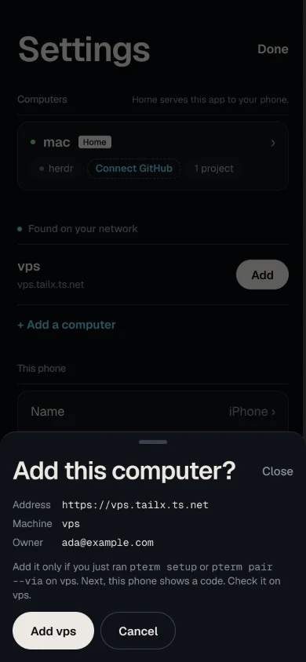
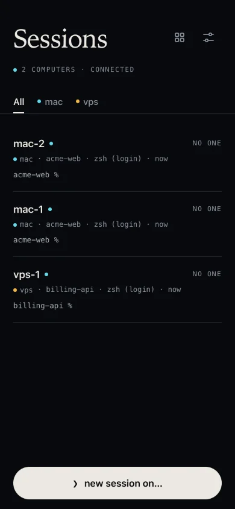
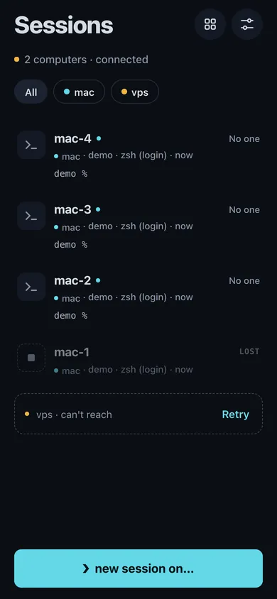

Termivoa lets one phone app use several computers, for example a Mac, a Linux server and a VPS, with one Sessions list and one Wall.

:::note[Next beta]
Not released yet. This is not in `v0.1.0-beta.2`, and it is not tested on a real phone yet. See [Is it tested on a real phone?](#is-it-tested-on-a-real-phone)
:::

:::caution[iOS 16.4 or later]
From the next beta, every Termivoa app needs iOS 16.4 or later, also with one computer. See [The app cannot load after the update](/docs/reference/troubleshooting/#the-app-cannot-load-after-the-update-iphone-next-beta).
:::

## How does it work?

| Word | What it means |
| --- | --- |
| Home | The computer whose address is on your Home Screen. It serves the app. |
| Peer | Any other computer you add. The app talks to it directly; nothing goes through home. |
| Via | The home address a peer accepts your phone from. `pterm devices` shows it in the **VIA** column. |

Each computer runs its own `pterm`, approves your phone itself, keeps its own login cookie for it, and can revoke it itself.

## How do I choose home?

Pick a computer that is **always on** and **safe**, such as a small server. Not the laptop where you run `npm install`, agents and dev servers.

:::caution
If home is hacked, every computer you added through it is at risk too, because home serves the app's code. See [What do I do if home was hacked?](#what-do-i-do-if-home-was-hacked)
:::

| Rule | Why |
| --- | --- |
| Only Termivoa on port 443 of each computer's Tailscale address | Any other Tailscale Serve handler there could control Termivoa. `pterm setup` refuses, and `pterm doctor` shows how to move it. See [Setup refuses other Tailscale Serve handlers](/docs/reference/troubleshooting/#setup-refuses-other-tailscale-serve-handlers-next-beta). |
| Changing home later means starting over | A new home is a new app, so you add every peer again. |

## How do I add a computer?

Start a wait on the new computer, then tap **Add** next to it in the app. You need `pterm setup` on the new computer, and both computers in the same tailnet with the same Tailscale user.

:::note[Next beta]
**Found on your network** and its **Add** button are not in `v0.1.0-beta.2`, and are not tested on real computers or a real phone yet.
:::

1. **On the new computer** (here `vps`), in a terminal:
   - If Termivoa is not set up there yet, run `pterm setup`. At **Is Termivoa already on your phone?** type `2` (**Yes, add this computer to it**), then pick home. The list shows each computer's full address and system, for example `1) mac — https://mac.tailx.ts.net (macOS)`. Pick the computer whose address your Termivoa app opens.
   - If it is set up, run `pterm pair --via mac`. Use home's machine name, or its full address such as `https://mac.tailx.ts.net`.

   It says **Sent to mac (https://mac.tailx.ts.net).** and waits for your phone for up to 10 minutes. Keep the terminal open.
2. **On your phone**, open **Settings → Computers**. Under **Found on your network**, tap **Add** next to **vps**.
3. **Check the sheet.** **Add this computer?** shows the **Address**, **Machine** and **Owner** that home found in its Tailscale status. Tap **Add vps**, then **Continue**.

   

4. **Compare the code and the name.** The app asks **Does vps show this code?** and says "If it matches, type y in the terminal on vps." On vps, the prompt says `Phone "iPhone" wants to use THIS computer (vps) from the Termivoa app at mac (…)`. Type `y` only if it names THIS computer (vps) and shows the same code. The app says **vps is added**.

   

You can leave the page to type `y` in the app's own terminal: tap **Back to terminal**. A bar says **Adding vps… approve on vps** until it is done.

| **Found on your network** shows | Meaning |
| --- | --- |
| **vps** · `vps.tailx.ts.net` · **Add** | vps waits to be added. The app checks the list every 5 seconds while **Settings → Computers** is open. |
| "To add another computer, run pterm setup on it, or pterm pair --via mac if it is already set up. It shows here while it waits." | No computer waits now. |
| "mac cannot read its Tailscale status. Check Tailscale on mac." | Home cannot see your tailnet now. Check Tailscale on home. |

A row goes away when that computer stops waiting or becomes another Tailscale machine. It is also hidden while that computer is in your list and answers. A computer that lost this phone's access (for example after `pterm revoke` there) shows again, so you can add it again from **Found**.

| If… | Then |
| --- | --- |
| No **Add** row shows up | Use the link: see [How do I scan or paste the link?](#how-do-i-scan-or-paste-the-link) and [Troubleshooting](/docs/reference/troubleshooting/#no-add-button-for-a-new-computer-next-beta). |
| The codes are different, or the prompt names another computer | Type `n`, then tap **Codes don't match? Cancel**. |
| You change your mind | Tap **Cancel** on the sheet, the page or the bar. After a `y`, the app also signs out of vps. |
| The app says "vps stopped waiting. On vps run pterm pair --via mac, then tap Add again." | vps no longer waits. Run `pterm pair --via mac` on vps, then tap **Add** again. |
| A computer is a tagged Tailscale node | **Add** does not work for it. Check its tags, then run `pterm pair --via mac --allow-tagged` and use the QR code or the link. |
| You want to approve later | `pterm pair --via mac --no-wait`, then `pterm pair pending` and `pterm pair approve <pending-id>`. This sends nothing to home: use the link. |

### Other ways: the link and the QR code

Under **Sent to mac**, `pterm pair --via` also prints a QR code and a link: "No Add button? In the app tap + Add a computer → Scan QR, or paste the link. They work for 2 minutes:". They work once, for two minutes. When they expire, the computer says "The QR code and link above expired. Add in the app still works." and keeps waiting. If nothing reached home, the command ends instead; run it again.

- **Tap it**, if you ran the command in a Termivoa session (for example after `ssh vps`).
- **Scan it** or **paste it**: **Settings** → **+ Add a computer**, then **Scan QR** or **Paste link**. See [How do I scan or paste the link?](#how-do-i-scan-or-paste-the-link)

Then check the sheet and compare the code as in steps 3 and 4. Without a terminal (for example with piped input), `pterm pair --via` sends nothing to home and waits only for the link, for two minutes.

| If… | Then |
| --- | --- |
| The link opened in Safari or the phone's Camera app | That page says **This page cannot add the computer**. Scan the QR code in the app instead (**Settings → + Add a computer → Scan QR**), or tap **Copy link** there and use **Paste link** in the app. Safari never adds the computer. |

## How do I scan or paste the link?

In **Settings → Computers**, tap **+ Add a computer**. Termivoa shows two choices: **Scan QR** and **Paste link**.

:::note[Next beta]
**Scan QR** is not in `v0.1.0-beta.2`, and it is not tested on a real phone yet.
:::

| Choice | What you do | What the app does |
| --- | --- | --- |
| **Scan QR** | Allow the camera, then point it at the QR code that `pterm pair --via` printed. | Reads the code inside the app, stops the camera, and opens **Add this computer?** |
| **Paste link** | Paste the whole link, then tap **Check link**. | Checks the link and opens **Add this computer?** |

Both choices give the app the same link, and the app checks it the same way. A scan never adds a computer by itself: you still check the **Address**, **Machine** and **Owner**, tap **Add vps**, tap **Continue**, and compare the code.

Scan with **Scan QR** in the app, not with the phone's Camera app. The Camera app opens the link in Safari, which is not signed in to your app and cannot add the computer.

| The app says | Meaning |
| --- | --- |
| **Allow the camera to scan the QR code.** | The phone asks for the camera. Tap **Allow**. |
| **Point the camera at the QR code that pterm pair --via printed.** | The camera is on. Hold the code inside the picture. |
| **The camera is blocked. …** | Allow the camera for the Termivoa address in your phone's or browser's settings, then tap **Scan QR** again. Or tap **Paste link**. |
| **No camera found. Paste the link.** | Tap **Paste link**. |
| **This is not an add-computer link. …** | The QR code is not from `pterm pair --via`. Scan the right code. |
| **This add-computer link expired or was already used.** | Run `pterm pair --via mac` again and scan the new code. |

The camera stops when the app reads a code, when you tap **Cancel**, and when you leave the app. The pictures stay on your phone: the app reads them there and saves nothing. See [Security](/docs/reference/security/#what-does-termivoa-store).

## What changes in the app?

| Screen | With 2 or more computers |
| --- | --- |
| Sessions | Chips **All**, **mac**, **vps** filter by computer. Each row has a colour dot and the computer's name. Waiting sessions come first, from all computers. |
| New session | **❯ new session on…** and a **Computer** row pick where it runs. Projects and shells come from that computer. |
| [Wall](/docs/guides/wall/) | Tiles from all computers. At most 4 are live at once (5 updates per second each); the rest show **Paused**. |
| Live, [Changes](/docs/guides/changes/), [Files](/docs/guides/files/) | Work the same on every computer. |
| [Dev-server preview](/docs/guides/preview/#can-i-preview-a-session-on-another-computer) | Works per computer. Each computer answers the preview question in `pterm setup` itself. A computer on an older Termivoa shows no **Preview ready** chip. The bar over a page from another computer shows `vps · untrusted page`. |
| [Notifications](/docs/guides/notifications/#do-notifications-come-from-every-computer) | Every computer sends them. One switch in **Settings → Notifications** controls all. The title and text of a notification from another computer start with its name (`vps · …`) and a tap opens that session. |

With one computer, the app looks the same as before.

## What if a computer is offline?

The other computers keep working. The one that does not answer gets its own row.

| Row | Meaning | Do this |
| --- | --- | --- |
| **vps · can't reach** and **Last seen 3 h ago. Is it on, and in your tailnet?** | Nothing answered from vps. The app cannot see why, so it asks. | Check that vps is on and in your tailnet, then tap **Retry**. |
| **vps · can't reach** and **This app page is out of date. Close the app and open it again.** | The app page on your phone does not allow vps yet. The app already reloaded once. | Close the app fully and open it again. |
| **Connecting to vps…** and **Just added. Its sessions show in a moment.** | vps was added a moment ago and does not answer yet. The app tries again by itself for about 5 seconds. | Wait. If it still does not answer, the row says **vps · can't reach**. |
| **vps · pair again** | vps no longer accepts this phone (revoked, logged out, expired, or Tailscale changed on home). | Run `pterm pair --via mac` on vps and add it again. |
| **Update Termivoa on vps** | Termivoa on vps is too old for this app. | Update Termivoa on vps. |

If a [preview](/docs/guides/preview/) of that computer is open, the preview is removed and the text shows in its place: **vps · can't reach**, **vps · pair again** or **Update Termivoa on vps**.

If home is offline, the app still opens from its saved copy and reaches the peers.

## How do I see if a computer is healthy?

Open **Settings → Computers**. Each computer shows the Termivoa version it runs and when the phone last got an answer from it.

:::note[Next beta]
Not in `v0.1.0-beta.2`.
:::

| You see | Meaning |
| --- | --- |
| **Home** next to a name | This computer is home. Under the heading the app says **Home serves this app to your phone.** |
| **Termivoa 0.1.0-beta.2+1a2b3c4d5e6f · last seen just now** | The version on that computer, and how long ago it answered (**just now**, **5 min ago**, **3 h ago**). |
| **vps · can't reach** and **Last seen 3 h ago. Is it on, and in your tailnet?** | vps does not answer now. The phone keeps the time of its last answer until you close the app. The question shows only when nothing answered at all. |
| **Check again** | Asks that one computer now. The row says **Checking…**, then **vps answered in 0.2 s.** or why it did not. |

**Check again** works on every computer, also on the one that says **can't reach**.

## How do I update the computers?

One at a time, in any order. The app refuses only a computer that is too old ("Update Termivoa on vps"). After you update home, tap **update** on the Sessions list, or close and open the app.

## How do I rename, remove or log out?

| Action | Where | What happens |
| --- | --- | --- |
| Rename | **Settings → Computers → Rename** | Changes the name on this phone only. |
| Remove | **Settings → Computers → Remove** | Signs this phone out of vps first; its sessions keep running. If vps cannot be reached, run `pterm revoke <device-id>` on vps. |
| Log out | **Settings → Log out** | Signs out of every computer it can reach, and names the ones it could not. Run `pterm revoke` there. |
| Remove for every phone | On home: `pterm computers remove https://vps.tailx.ts.net` | Takes vps off every phone's list. Run `pterm revoke` on vps too. |

Home cannot be renamed or removed here.

## What do I do if home was hacked?

1. On **every peer**, run `pterm revoke --via https://mac.tailx.ts.net` and type `y`.
2. Clean or replace home.
3. Remove the app's data from the phone:
   - **iPhone:** delete the Termivoa app from the Home Screen.
   - **Android:** remove the app, then in Chrome go to **Settings → Site settings → All sites**, pick home's address and delete its data.
4. Add home to the Home Screen again, [pair your phone](/docs/pair-your-phone/), and add each peer again.

Every step matters: a hacked home can leave a hidden background script on the phone, and can hold a peer cookie for up to 30 days. Step 1 ends that cookie.

## What do I do if I lose my phone?

1. On home: `pterm devices`, then `pterm revoke <device-id>`. It lists the other computers the phone used.
2. On each of them: `pterm devices` (the **VIA** column shows home), then `pterm revoke <device-id>`.

## What are the limits?

| Limit | Why |
| --- | --- |
| One tailnet, one Tailscale user | Each computer checks that home belongs to you. |
| At most 8 computers plus home | For each phone. |
| WSL cannot be a peer | Tailscale usually runs on Windows, so WSL cannot check the tailnet. |
| A preview from another computer is an **untrusted page** | That computer chooses the page. See [What does "untrusted page" mean?](/docs/guides/preview/#what-does-untrusted-page-mean) |
| Reinstalling Tailscale | On home: peers show **pair again**. On a peer: home drops it from the list; add it again. |

## Is it tested on a real phone?

Not yet. Chrome and WebKit pass every automated check with two test computers, but the check on a real iPhone and Android phone has not run. If it fails on iPhone, the design changes before release.
