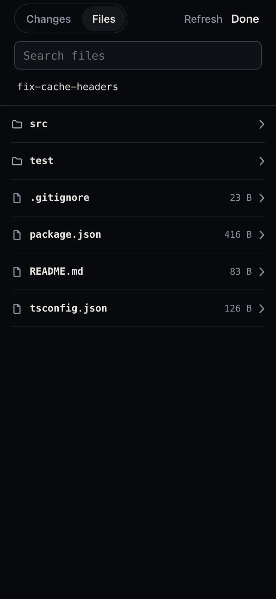
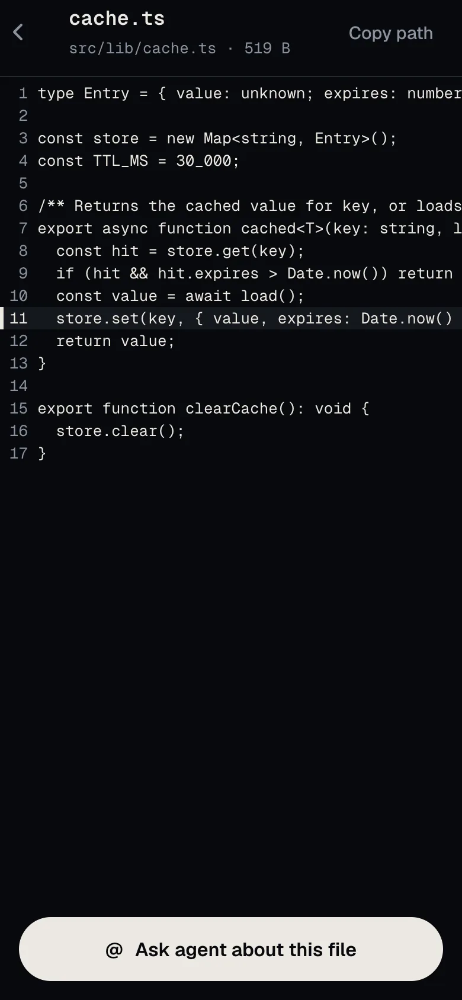

Termivoa's **Files** tab shows the project folder of a session on your phone: browse folders, search file names, and read any text file. It only reads; it never changes a file.

:::note[Next beta]
Not released yet. This is not in `v0.1.0-beta.2`.
:::

## Open Files

1. In a session, tap **changes** in the dock, or **Changes** when you only watch.
2. Tap **Files** at the top.

You do not need control. Termivoa remembers the last tab for each session while the app is open.

## Which folder does Files show?

Files starts at the top of the git repository that holds the session's current folder. When the folder is not in a repository, Files starts at that folder. Files never shows anything above that point.

- Folders come first, then files, A to Z. Each file shows its size.
- The `.git` folder is never shown.
- A link that points outside the project is dimmed and does not open.
- A folder shows at most 1000 entries.

Tap a folder to open it. Tap a name in the path at the top to go back up.

## Read a file

Tap a file to read it with line numbers. Long lines scroll sideways and never wrap.

| You see | What it means |
| --- | --- |
| **This file is not text.** | A binary file, such as an image. |
| **The file is cut short here (256 KiB).** | Only the first 256 KiB are shown. See the rest on your computer. |
| **This file is over 50 MiB, too large to show.** | Termivoa does not open it. |
| **This file is not there anymore.** | It was moved or deleted. Tap **Show its folder**. |

**Copy path** (top right) copies the file's path in the project. **Ask agent about this file** opens compose with `@path`, so you can ask the agent about it. Nothing is sent until you tap **Send ⏎**.

## Search for a file

Type in **Search files**. Termivoa finds every file whose path contains your text, with names that match first. It shows up to 200 results.

In a git repository, search skips files that git ignores, such as `node_modules`. Outside a repository, it skips `.git` and `node_modules`.

## Open a file from the terminal

Tap a file path in the terminal, such as `src/app.ts:42`, to open that file at that line. This works for paths with a line and column (`src/app.ts:42:7`), the TypeScript form (`src/app.ts(42,7)`), relative paths (`./src/app.ts`) and full paths inside the project. A tapped folder opens in the list.

- A swipe that starts on a path scrolls as usual; only a tap opens it.
- Web addresses, version numbers and paths outside the project are not links; a tap there works as a normal tap.

## Common questions

### Can Files change or delete my files?

No. Files only lists, searches and reads. To change a file, ask the agent or type in the terminal.

### Why do I not see a file that is on my computer?

Files shows the project of this session only. Check that the session is in the right folder (the path above the terminal), then tap **Refresh**. If your computer does not answer within 15 seconds, Files says it could not read the folder; tap **Retry**. Search skips files that git ignores; browse the folder to see them.

### Who can read my files?

Only your paired phones, over your private Tailscale network. See [Security](/docs/reference/security/).
