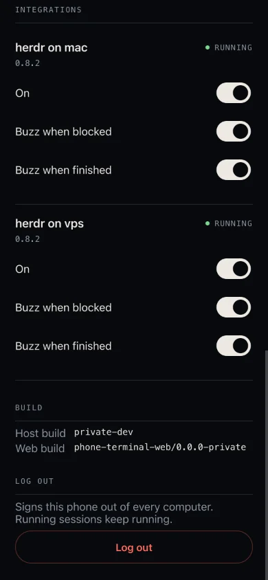

Termivoa shows the projects of your computers' herdr on your phone, so you can see which coding agent is blocked, open its terminal and answer it.

:::note[Next beta]
This page describes features that are not in `v0.1.0-beta.3` yet. Update Termivoa on the computer to the next beta to get them.
:::

## What is herdr?

[herdr](https://herdr.dev) is a terminal workspace tool. It runs coding agents in workspaces, tabs and panes. Termivoa reads each computer's herdr and shows its projects on the phone. It opens one herdr terminal at a time in [Live](/docs/guides/live-terminal/).

A computer without herdr shows no herdr tab, and nothing changes.

## What do I need?

| Need | Detail |
| --- | --- |
| herdr 0.8.2 or later | Installed on that computer: Homebrew `herdr`, or on your `PATH`, or in `~/.local/bin` or `~/.cargo/bin`. |
| herdr running | Its server must run. Only the default herdr session shows. Named herdr sessions do not show. |
| macOS or Linux | Windows is not supported. |
| Termivoa from the next beta | On that computer. |
| A setting | None. Termivoa finds herdr by itself within about 30 seconds, also when you install herdr while Termivoa runs. The phone shows it the next time you open Termivoa or switch back to it. |

## What do I see on the phone?

On the Sessions list, a **herdr** tab sits next to **All** (with one computer) or with the computers' chips. A number on the tab counts the terminals that are blocked or done, over all computers.

In the **herdr** tab:

- One row for each project (a git repository). Tap ▸ or ▾ to fold or unfold it.
- Under a project, its worktrees, with the main checkout first. A workspace that is not in git is one row.
- With more than one computer, each project says where it is, such as **on mac** or **on vps**.
- A folded project with several worktrees says **2 worktrees**.
- A line under a worktree names the agent and the tab, for example `claude · tab 1`. It never shows terminal titles or screen text.

A state word shows on the right of a row:

| Word | Meaning |
| --- | --- |
| **BLOCKED** (amber) | The agent waits for you. |
| **DONE** | The agent finished. It stays until someone looks at it in herdr on the computer. A DONE row that you opened on the phone is dimmed. |
| **WORKING** | The agent works. |
| **IDLE** | The agent is idle. |
| no word | The state is unknown, or there is no agent. |

A project shows its most urgent word with a count, such as **1 BLOCKED** or **2 WORKING**.

The status line says, for example, `1 blocked · 1 done · 2 working`, or `herdr · nothing running`. When something is blocked, the button **Open the blocked agent** opens the first blocked agent.

The **All** tab also lists the herdr worktrees that have an agent with a state, under **HERDR**, above **Termivoa sessions**.

### What if herdr has a problem?

The problem shows on the **herdr** tab only. The Sessions list never waits for herdr.

| Message | What to do |
| --- | --- |
| **herdr is not running on mac** | Start herdr there. Its projects then show here. |
| **Update herdr on mac** | This version is too old for Termivoa. Update to herdr 0.8.2 or later. |
| **herdr on vps · can't reach** | Tap **Retry**. |

## How do I open a terminal and answer?

1. In the **herdr** tab, tap a worktree row.
2. The herdr terminal opens full screen in Live. The tabs of that herdr workspace show as chips on top. **‹ Sessions** goes back.
3. It opens read-only. Tap **Take control** to type. See [Take control to type](/docs/guides/live-terminal/#take-control-to-type).

The keys, typing, compose, snippets, answer cards and Changes work as in any session. These are not offered for a herdr terminal: History, rename, end session, photos, project buttons that start a new session, preview and the worktree menu.

A tab without an agent opens too (herdr 0.8.2 and later). If herdr cannot open it, its chip is off and says **Update herdr to open this tab**.

If the herdr pane closes while you watch, Live says **Closed here** and "This terminal is no longer open on this phone. Its row in Sessions stays." Tap **Open again**.

## When does the phone buzz?

The phone buzzes when a herdr agent is blocked or finished. Turn on notifications first: see [Turn on notifications](/docs/guides/notifications/#turn-on-notifications).

| When | Text |
| --- | --- |
| An agent is blocked | `<agent> needs you. Tap to answer.` |
| An agent finished after work | `<agent> finished after <N> min.`, or `<agent> finished.` under a minute |

- The title is `herdr · <project> · <worktree>` (one name when both are equal). A name is cut to 40 characters.
- A finished buzz needs at least 20 seconds of work that Termivoa saw.
- A blocked buzz needs the agent to stay blocked for two checks in a row (about 2 seconds), so a short blip does not buzz.
- A tap opens that terminal at once.
- herdr buzzes have their own limit, 6 per minute, so they never use up the buzzes of your normal sessions.
- The text has only the agent and the project and worktree names, never terminal text.

## How do I turn herdr off or the buzz off?

Open **Settings → Integrations**. It has one card for each computer that has herdr, such as **herdr on mac**. The card shows the herdr version and a state word: **Running**, **Not running**, **Update** or **Off**.

| Switch | What it does |
| --- | --- |
| **On** | Off: the herdr tab leaves out that computer, the computer stops reading herdr and closes its open herdr terminals, and there is no buzz. The card says "This phone does not show or buzz for herdr on mac." |
| **Buzz when blocked** | Turns the blocked buzz on or off. |
| **Buzz when finished** | Turns the finished buzz on or off. |

The switches are saved on that computer, for every phone.

## How do I create a worktree?

A worktree is a second folder of a git repository on its own branch. herdr makes it and can start an agent in it.

1. In the **herdr** tab, tap **+** on a git project row.
2. In the sheet **New worktree**, type a **Branch name**: lowercase letters and digits joined by `-`, `.`, `_` or `/`, such as `fix/login-redirect`. It can have up to 64 characters and at most 4 parts.
3. Under **Start an agent in it**, tap an agent that already runs in this herdr (such as `claude` or `codex`), or **No agent**.
4. Optional: write a **First prompt (optional)**. It cannot have control characters such as Esc.
5. Tap **Create and start** (or **Create** with **No agent**).

The sheet says "herdr makes the folder and a new branch from where shop is now." It takes up to about 45 seconds. Then the new terminal opens.

If something goes wrong, the app says why:

| Message | What to do |
| --- | --- |
| "fix-login" already exists in shop. Pick another name. | Use another branch name. |
| shop is not in git, so it cannot have worktrees. | Use a project that is in git. |
| herdr could not make the worktree. Nothing was opened. Try again or pick another name. | Try again, or pick another name. |
| Too many new worktrees just now. Wait a minute, then try again. | Wait a minute. |
| The worktree is ready, but the agent did not start. | Open the worktree and start the agent yourself. |
| The agent started and waits at a question. Your prompt was not sent. | Answer the question, then send the prompt. |
| The agent started, but your first prompt was not sent. | Send the prompt yourself. |

## Why is the pane small on my laptop?

herdr gives a pane the size of whoever attached last. Termivoa opens the herdr terminal at the phone's size, so it fits the screen. The line under the chips says it: "mac shows this terminal at phone size while it is open here."

The laptop pane takes the phone's size, and you can still type there. When you leave Live, or lock the phone or switch apps, the phone stops watching. About 10 seconds later, herdr gives the laptop pane its own size back. When you come back, the terminal opens again.

## What are the limits?

| Limit | Detail |
| --- | --- |
| Open terminals | At most 4 herdr terminals open at once for each computer. The app says "Too many herdr terminals are open on mac. Close one, or wait a few seconds." They do not count toward Termivoa's own session limit. |
| Panes | One pane for each open terminal. No split panes. |
| Input | No mouse. No herdr prefix keys: Termivoa sends `ctrl+b` to the agent as a plain `ctrl+b`, so the phone cannot send herdr's prefix commands. |
| Custom prefix | If you set another prefix key in herdr's `config.toml`, the phone can send that key. At worst it closes the phone's own view of the terminal. `pterm doctor` warns about it. |
| Control | Opening never takes control. You tap **Take control**. |
| Where they show | herdr terminals are not in the Sessions list, the Wall or `pterm list`. |
| After a restart | Termivoa does not keep them when it restarts. Open the row again. |
| Platforms | macOS and Linux. Not Windows. |
| herdr sessions | Only the default herdr session. Not named sessions. |

## Common questions

### Why is there no herdr tab?

herdr is not installed on that computer, or Termivoa cannot find it, or **On** is off in **Settings → Integrations**, or Termivoa there is older than the next beta. Run `pterm doctor` on the computer. See [The herdr tab is missing](/docs/reference/troubleshooting/#the-herdr-tab-is-missing).

### Can I open a herdr terminal from a link?

Yes. A link to a herdr terminal, or a reload of its page, first shows its names and an **Open** button: "Open shows it here, read-only." It opens only after you tap **Open** in the app, or tap a notification. If the terminal is gone, the herdr tab says "That terminal is gone."

### Can the phone kick my laptop out of a pane?

No. Termivoa never takes a pane over from another herdr client. See [What does the phone see and do with herdr?](/docs/reference/security/#what-does-the-phone-see-and-do-with-herdr)

### Does this work with several computers?

Yes. Each computer reads its own herdr. The **herdr** tab shows all of them, and each project says **on mac** or **on vps**. See [Use several computers](/docs/guides/computers/#how-do-i-add-a-computer) to add one.
