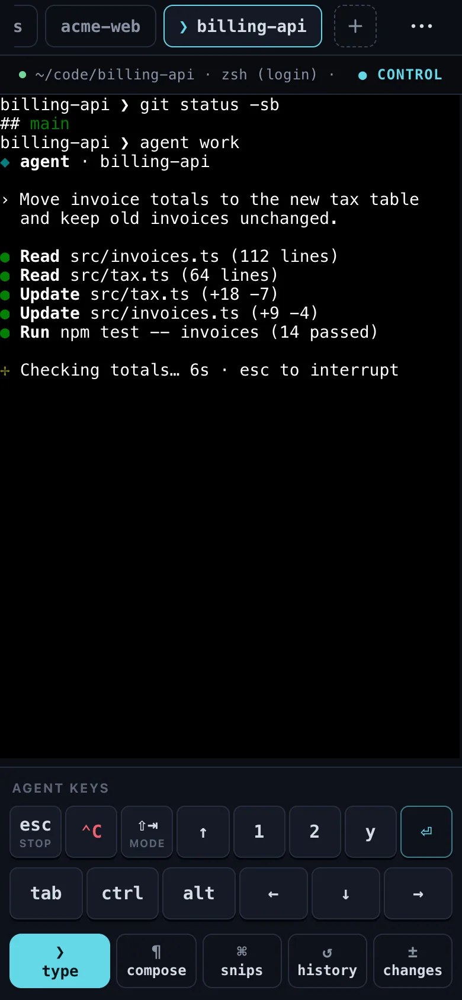
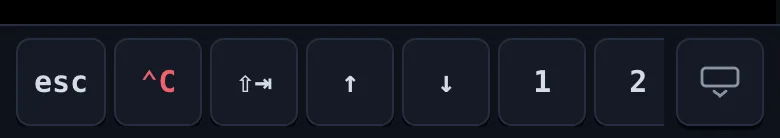

Termivoa's live terminal is the screen of one session, where you read output and type from your phone. Open it from the Sessions list or Wall.

## What changes for busy terminals?

| Version | Watching output |
| --- | --- |
| **Next beta** | Live and Wall use less CPU and temporary memory on the computer while output changes. The terminal controls and display stay the same. |

## Take control to type

Many devices can watch a session; only the one with **control** can type.

- A session opens read-only, showing **READ-ONLY** and who has control.
- Tap **Take control**. The screen shows **● CONTROL**; the other device becomes read-only.
- To give it away, open the session menu (**⋯**) and tap **Release control**.

:::note
Termivoa never queues or resends typing. If the connection breaks while you type, you see "Delivery uncertain—check the terminal before sending again". Look at the terminal before you send it again.
:::

## Switch sessions with the tabs

The tab bar at the top shows your running sessions. Tap a tab to switch; each opens read-only. A dot marks new output; an amber dot means it waits for you. **+** starts a new session.

## Use the agent keys and key bar

With control, the dock under the terminal shows one-tap agent keys and a key bar with keys a phone keyboard lacks.



| Key | What it sends |
| --- | --- |
| `esc` | Escape. Stops a coding agent. |
| `⌃C` | Only Ctrl+C, even when `ctrl` is on. |
| `⇧⇥` | Shift+Tab. Changes the agent's mode. |
| `1`, `2`, `y` | That character. Picks an agent option. |
| `⏎`, `tab` | Enter, Tab. |
| `ctrl`, `alt` | Holds Ctrl or Alt for the next key. |
| `↑`, `←`, `↓`, `→` | Arrow keys. |
| `▲`, `▼` | Scrolls a full-screen app. Shows only while one is open. |

The action buttons are **type** (opens the phone keyboard), **compose**, **snips**, **history** and **changes** (see [Changes](/docs/guides/changes/)).

With the phone keyboard open, all keys fold into one scrolling row, and the terminal keeps its size so full-screen agents do not redraw. `↓` follows `↑` there.



## Write longer text with compose

Tap **compose** for long or multi-line text. Nothing is sent until **Send ⏎**, which pastes it and presses Enter. Text with more than one line asks before it sends. Compose can also add a [photo or your voice](/docs/guides/photo-and-voice/).

## Save and send snippets

Snippets are prompts and commands you send with one tap, saved on this phone only. Tap **snips** to open the Snippets sheet.

- Save: tap **+ New**, fill in **Title** and **Text to send**, pick **Press Enter after pasting** to run it at once, and tap **Save**.
- Send: tap it (needs control). A snippet with more than one line asks first.
- Change or delete: tap **Edit**, then the snippet.
- **This project**: your project's own commands. See [Project buttons](/docs/guides/project-buttons/).

## Scroll the terminal

- **Full-screen apps** such as Claude Code, Codex, `vim` or `less`: swipe on the terminal or tap `▲`/`▼` (needs control).
- **A normal shell:** pull down, or tap **history**.

## Copy from history

1. Tap **history**.
2. Select text.
3. Tap **Copy N lines**, for example **Copy 3 lines**.
4. Tap **Done**.

## Change the text size

In the session menu (**⋯**), open **Settings** and tap **A−** or **A+** under **Terminal text size**.

## Move between desktop and phone

Open the same session in a terminal on your computer. `pterm list` shows the IDs:

```sh
pterm attach <session-id>             # watch
pterm attach --control <session-id>   # type
```

Press Ctrl+] to leave; the session keeps running. When you take control on the phone, the desktop becomes read-only, and the other way around.

## Common questions

### Why did I lose control?

Another device took control, or you locked the phone or switched apps. Tap **Take control** again.

### How do I send Ctrl+C?

Tap `⌃C`, or tap `ctrl` and then type `c`.
