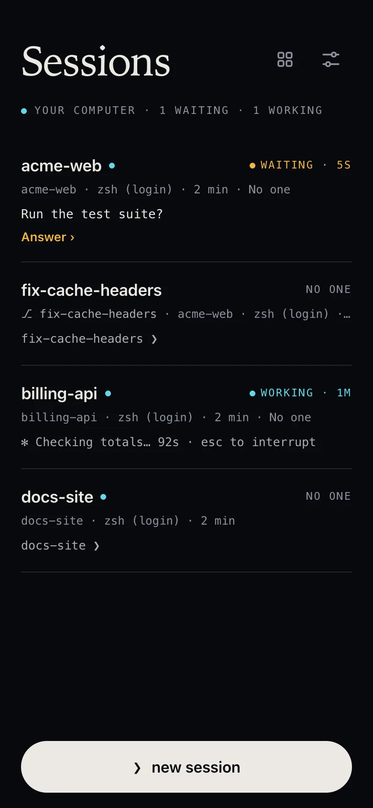

Termivoa shows every session on your computer in the Sessions list, the first screen after pairing. A session is one running shell or coding agent, such as Claude Code or Codex.

## Read the Sessions list

Each row shows:

- the session name, which follows the folder after `cd` unless you renamed the session;
- the project, shell and age, for example "Home · zsh · 35 min";
- the last line of output, or the question when an agent waits for you;
- a dot for new output since this phone last opened it.

Sessions that wait for you are at the top. Tap a row to open it in the [live terminal](/docs/guides/live-terminal/), which shows the session's full folder path.

## Start a session

1. Tap **new session**, or **+** in the live terminal tab bar.
2. Pick a project (a folder where new sessions start) and a shell.
3. Optional: in **run first**, type one command, such as `claude` or `codex`.
4. Tap **start session**.

The **run first** command is typed once, with Enter, only if no one else has control. Otherwise Termivoa sends nothing and says why. **save as preset** keeps your choices under **Launch** for a one-tap start. Add projects on the computer with `pterm project add <folder>`.

## What do the status badges mean?

| Badge | Meaning |
| --- | --- |
| **Working** | Busy, or printed output in the last few seconds. |
| **Waiting** | An agent or `[y/N]` prompt waits for you. The row shows the question and **Answer ›**. |
| **Your turn** | An agent finished and you have not opened the session since. |
| **Exited** | The shell ended, with its exit code if any, for example **Exited · 1**. |
| **Lost** | The computer restarted, you logged out, or the broker (the background process that owns sessions) stopped. |

A plain shell at its prompt shows no badge. Waiting sessions can [notify your phone](/docs/guides/notifications/). After time away, a [recap card](/docs/guides/recap/) says what happened.

## Rename a session

1. In the session, open the session menu (**⋯**).
2. Tap **Rename…**, type a new title and tap **Save title**.

## End a session

1. Open the session menu (**⋯**) and tap **Terminate…**.
2. Tap **Terminate session**, or **Keep running** to cancel.

This stops the program and everything it started. On the computer, get the ID from `pterm list` and run `pterm terminate <session-id>`.

## Common questions

### Does a session stop when I close Termivoa?

No. It runs on the computer until the program exits, you end it, or it is lost.

### Why does it say "This session is gone"?

The session ended and cannot come back or open. It stays on the list as **Exited** or **Lost**. Start a new session. Termivoa never runs old commands again.
