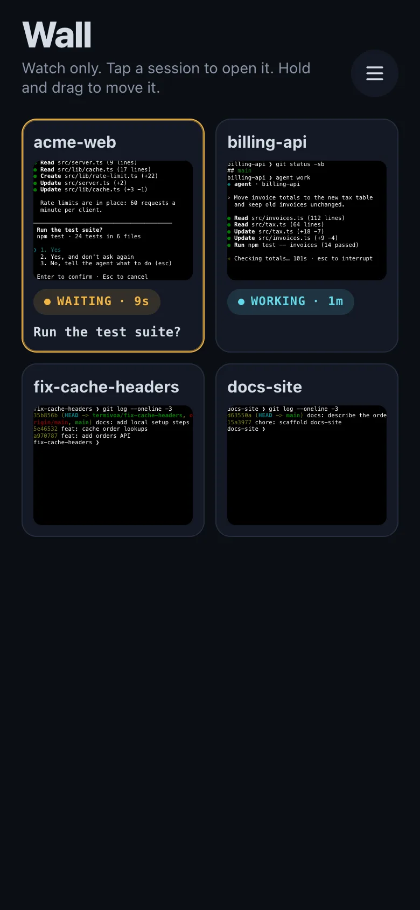

Termivoa shows every running session as a small live screen on one page, the Wall.

## Open the Wall

1. On the Sessions list, tap **Wall** (the grid icon) at the top. The tiles update live.
2. Tap a tile to open that session in the [live terminal](/docs/guides/live-terminal/).
3. To go back, tap the list button at the top, or use the back gesture.

If no session runs, the Wall shows **No running sessions** and a **new session** button.

## What does a tile show?

Each tile shows the session's screen, scaled to fit and following the newest line. You can see output, colors and prompts. Each tile also shows:

- the session name;
- the [status badge](/docs/guides/sessions/#what-do-the-status-badges-mean): **Working**, **Waiting** or **Your turn**;
- the question, when an agent waits for you;
- an amber dot in the corner while the tile reconnects.

From the next beta, at most 4 tiles are live at once, and each updates up to 5 times per second. Tiles off the screen, tiles over that limit, and all tiles while the app is in the background keep their last screen and show **Paused**.

## Which tiles come first?

Tiles that wait for you come first, with an amber border. Working sessions come next, then the rest. Ended sessions are not shown; a line under the tiles counts them.

## Arrange the tiles

:::note[Next beta]
Not released yet. This is not in `v0.1.0-beta.2`.
:::

1. Touch and hold a tile until it lifts.
2. Drag it to its new place. Drag to the top or bottom edge to scroll.
3. Let go.

A quick swipe still scrolls, and a quick tap still opens the session. With a keyboard, focus a tile and press Alt and an arrow key to move it one place.

The order is saved on this phone only. New sessions go after the tiles you arranged. To go back to the default order, tap **Reset order** under the tiles.

## Why can I not type on the Wall?

Tiles only watch. They never take control, type, or change the terminal size. To type, tap the tile, then tap **Take control**. The tiles connect only while the Wall is open.
