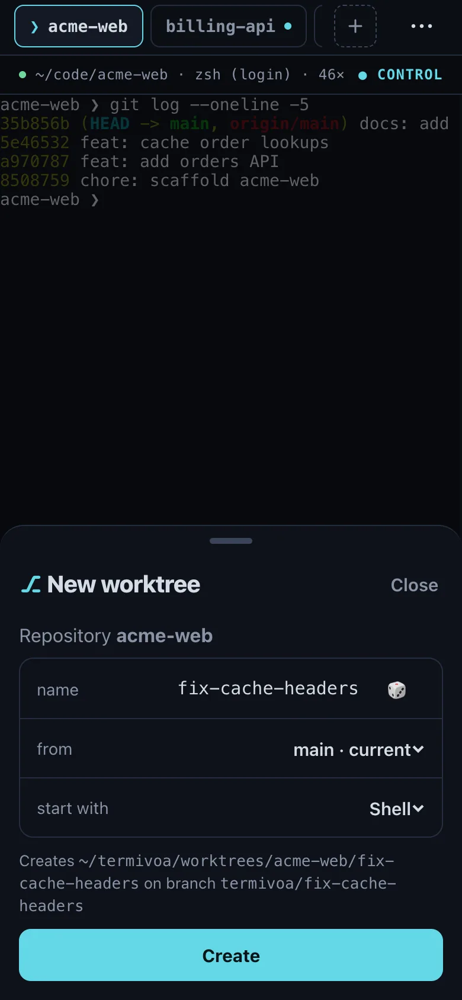

Termivoa can start a new task in a git worktree: a second folder of your repository on its own branch, with a new session in it. Two agents in two worktrees do not change each other's files. All worktrees share one history, so you commit and push as usual.

:::note[Next beta]
Not released yet. This is not in `v0.1.0-beta.2`.
:::

## Make a worktree

1. In a running session, `cd` into your repository, such as `~/code/myapp`.
2. Open the session menu (**⋯**), then tap **New worktree…**.
3. Check the fields:
   - **name**: random at first, such as `brave-otter`. Tap 🎲 for another. Use lowercase letters, digits and single hyphens, up to 40 characters.
   - **from**: the branch to start from. The default is the repository's default branch, such as `main`. You can pick any local or remote branch.
   - **start with**: **Shell**, **Claude** or **Codex**.
4. Tap **Create**.

Termivoa makes the folder `~/termivoa/worktrees/<repository>/<name>` and the branch `termivoa/<name>` from the branch you picked. A new session, named after the worktree, opens in that folder as a new tab.

The new branch does not track a remote. A push from [Changes](/docs/guides/changes/#commit-and-push) sends it to `origin` as a new branch, ready for a pull request.

:::tip
Start from `main` for a new task. To continue another task, pick its branch in **from**.
:::

## See your worktrees

A worktree session shows a **⎇ name** badge on the Sessions list and in the line above the terminal. The folders in `~/termivoa/worktrees` open in your editor like any other folder.

## Remove a worktree

Remove a worktree when its task is done and pushed.

1. Open the worktree's session and take control.
2. Open the session menu (**⋯**), tap **Remove worktree…**, then **Remove worktree**.

Termivoa deletes the folder and ends the session. The branch `termivoa/<name>` stays, so no commit is lost.

If the folder has uncommitted changes, new files, or files that git ignores (such as `node_modules` or `.env`), Termivoa asks first. **Remove anyway** deletes them for good. **Keep it** stops.

## What are the limits?

One repository can have up to 50 worktrees in `~/termivoa/worktrees`. Remove one to make more.

## Common questions

### Why can I not make a worktree?

**New worktree…** shows only for a running session. Its folder must also be in a git repository. If not, the sheet says so: `cd` into the repository first.

### Why does Create say the name already exists?

A name can be used once per repository. The folder or the branch `termivoa/<name>` already exists, so pick another name or tap 🎲.
