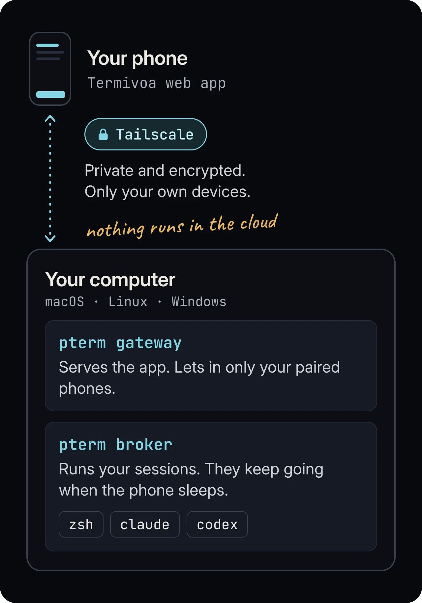

Termivoa lets you use the terminal sessions on your own computer from your phone's browser, privately over Tailscale.
A session can be a shell or a coding agent, such as Claude Code or Codex.

Status: free and open-source beta (`v0.1.0-beta.4`). Anyone can download it; the binaries are not signed yet.

## What is Termivoa?

Termivoa is a phone web app plus a host program, `pterm`, that runs your sessions on your computer, not in a cloud.
There is no account, no cloud service and no telemetry (usage data sent to a company).

## Who is it for?

People who run long terminal jobs or coding agents and want to check on them away from the desk, for example to answer a Claude Code question from the sofa.

## How does it work?

1. **Your computer runs `pterm`.** It keeps sessions alive and serves a private web page.
2. **Tailscale links your devices** in a private network. Only your own devices can reach the page.
3. **Your phone opens the page.** Pair it once, then watch, type and answer from anywhere.

## What you need

| Part | Requirement |
| --- | --- |
| Computer | macOS (Apple Silicon), Linux (Ubuntu 22.04 or 24.04) or Windows 11 (x64). It must stay awake and logged in. |
| Phone | iPhone with Safari, or Android with Chrome. iPhone needs iOS 16.4 or later. |
| Network | [Tailscale](https://tailscale.com/download) on the computer and the phone, signed in to the same account. |

## Common questions

### Is Termivoa free?

Yes. Termivoa is free and open source under the Apache-2.0 license. The code is on [GitHub](https://github.com/intojhanurag/Termivoa).

### Do my sessions stop when I close the phone app?

No. They keep running when you close the app, lock the phone or lose signal.

### Do I install an app from an app store?

No. The phone side is a web page. On iPhone, add it to the Home Screen for notifications.

### Can I use it away from home Wi-Fi?

Yes. Tailscale works from any network.

## Next steps

- [Quick start](/docs/quick-start/): from zero to a paired phone.
- [Install on macOS](/docs/install/macos/), [Install on Linux](/docs/install/linux/) or [Install on Windows](/docs/install/windows/).
