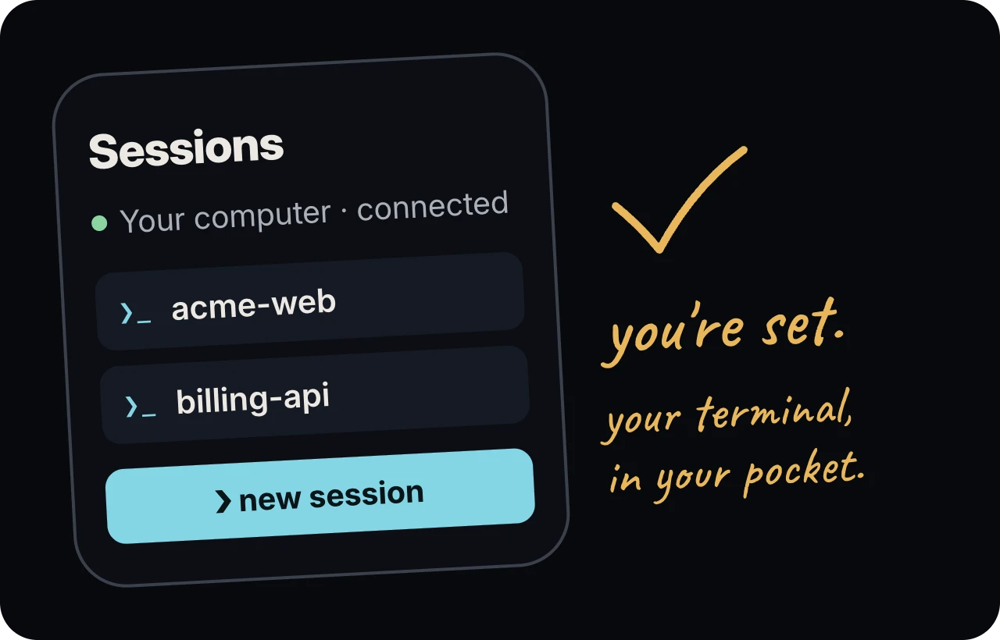

Termivoa takes about five minutes to set up, from install to your first session on the phone.

Status: Private beta (`v0.1.0-beta.2`). You need an invite to download it.

## Before you start

- Install [Tailscale](https://tailscale.com/download) on your computer and your phone, signed in to the same account.
- Install the [GitHub CLI](https://cli.github.com/) (`gh`) and run `gh auth login`.

## 1. Install pterm

Follow [Install on macOS](/docs/install/macos/), [Install on Linux](/docs/install/linux/) or [Install on Windows](/docs/install/windows/).

## 2. Run setup

If the install steps did not start it, run `pterm setup`.
Setup checks first and changes nothing. Then it lists its changes and asks `Continue? [y/N]`.

1. Read the list, type `y` and press Enter.
2. A separate question asks to share the page with your Tailscale devices. Type `y` if the command shown is correct.
3. An optional third question is about dev-server previews (port 8443).

Setup starts Termivoa at every login. If you have no project yet, it adds your home folder as the project **Home folder** (**Next beta**; the latest release names it **Home**).
It never uses Tailscale Funnel; the page is never public.

## 3. Scan the QR code

Setup ends with a QR code.

1. Scan it with the phone camera and open the link.
2. Type a name for the phone and tap **Pair this device**.

The link works once and expires after two minutes. Run `pterm pair` for a new one.

## 4. Approve the code

The phone shows a code, such as `485-431`. Your computer shows its code and asks `Approve? [y/N]`.
Type `y` if the codes match, `n` if not.

![Your computer prints "Phone 'My iPhone' shows code 482-913. Approve? [y/N]" and your phone asks "Does your computer show this code?" above the same six digits; a hand-written note says: same six digits? type y. Below it: No match? Type n.](../../../assets/docs/illo-pairing.webp)

On iPhone, tap **Share**, then **Add to Home Screen**, to get notifications.

## 5. Start your first session

1. Tap **new session**.
2. Pick a project and a shell.
3. Optional: in **run first**, type a command such as `claude`.
4. Tap **start session**.
5. Tap **Take control** to type.

Closing the app does not stop the session.



## Common questions

### I answered no to the Tailscale question. How do I share the page later?

Run `pterm setup` again and answer `y`, or run:

```sh
tailscale serve --bg --https=443 http://127.0.0.1:8787
```

### How do I check that everything works?

Run `pterm doctor`. It changes nothing and never prints secrets.

## Next steps

- [Pair your phone](/docs/pair-your-phone/): add or remove phones.
- [Sessions](/docs/guides/sessions/) and [Live terminal](/docs/guides/live-terminal/).
- [Troubleshooting](/docs/reference/troubleshooting/) if something fails.
